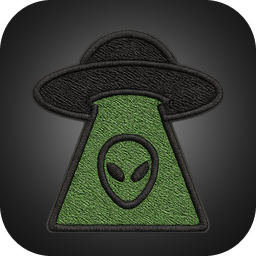

<p align="center">
  
</p>

<h1 align="center">jebaited_player</h1>

<p align="center">
  Lagani video player za Windows koji sam pronađe hrvatske titlove, provjeri pripadaju li tvom videu i uskladi ih s govorom.<br>
  <a href="#english">English below</a>
</p>

---

## Što radi

- **Reproducira gotovo sve:** MKV, MP4, AVI, MOV, WMV, WebM, TS… H.264, HEVC, AV1, VP9, 4K i HDR, 5.1 zvuk. Hardversko dekodiranje (mpv).
- **Titlovi sami od sebe:** kad uz video nema hrvatskih titlova, player ih potraži na internetu (OpenSubtitles, SubDL, Titlovi.com), odabere one za tvoje izdanje i učita ih.
- **Sinkronizacija prema govoru:** titlove usporedi s govorom u filmu i ispravi pomak, brzinu (npr. 25 / 23,976 fps) i skokove kod druge montaže. Titlove druge epizode ili filma odbije.
- **Ručna sinkronizacija bez muke:** pauziraj kad čuješ repliku, odaberi je s popisa i klikni „Ova replika počinje sada”.
- **Serije:** popis epizoda, nastavak gledanja gdje si stao, sljedeća epizoda sama krene.
- **Hrvatski znakovi** u svim starim kodiranjima (Windows-1250, ISO-8859-2, UTF-8…) prikazuju se ispravno.
- Audio trake, brzina reprodukcije, omjer slike, snimke zaslona, omiljeni, tamna i svijetla tema.
- **Nadogradnje same od sebe**, a postavke, povijest gledanja i ključevi ostaju.

## Instalacija

1. Otvori [najnovije izdanje](https://github.com/jebaitedcro7/jebaited_player/releases/latest) i preuzmi **`JebaitedPlayer-win-Setup.exe`**.
2. Pokreni ga. Instalacija traje nekoliko sekundi i ne traži administratora (program ide u `%LOCALAPPDATA%\JebaitedPlayer`). Na radnoj površini i u izborniku Start pojavi se prečac **jebaited_player**.
3. Windows može prikazati plavi prozor „Windows je zaštitio vaše računalo” jer program nije digitalno potpisan (potpis košta nekoliko stotina eura godišnje). Klikni **Više informacija → Ipak pokreni**.

Treba ti Windows 10 ili 11 (64-bitni). .NET nije potrebno instalirati, sve je u paketu (~115 MB preuzimanja, najviše zbog engine-a za reprodukciju sa svim kodecima).

**Prijenosna verzija:** `JebaitedPlayer-win-Portable.zip` raspakiraj bilo gdje i pokreni `jebaited_player.exe`. Ne mijenja ništa u Windowsu (nema „Otvori pomoću”), a nadogradnje rade i u njoj.

## Prvo pokretanje

1. **Titlovi s interneta:** player otvori kratki vodič. Za OpenSubtitles (preporučeno) trebaju besplatan račun i besplatan API ključ: vodič otvori stranicu za registraciju i stranicu s ključevima, ti upišeš korisničko ime i lozinku i zalijepiš ključ, a player sve provjeri i spremi. SubDL i Titlovi.com su neobavezni. Vodič možeš otvoriti i kasnije: desni klik → **Postavke…** → Titlovi → **Titlovi s interneta (vodič)…** (dok gledaš video i: desni klik → Titlovi → Postavi titlove s interneta…).
2. **Zadani player (neobavezno):** desni klik → **Postavke…** → Windows → **Postavi kao zadani player…** Otvorit će se Postavke sustava Windows; klikni „Postavi zadano”. Windows ne dopušta programima da to naprave sami.
3. Otvori video: dvoklik na datoteku, **Otvori pomoću → jebaited_player**, povuci datoteku ili cijelu mapu serije u prozor, ili Ctrl+O.

## Titlovi

- **Uz video:** titlovi istog naziva (`Film.srt`, `Film.hr.srt`, `Film.hrv.srt`…) i titlovi unutar MKV-a učitaju se sami. Redoslijed jezika: hrvatski, srpski, bosanski, engleski (mijenja se u postavkama titlova).
- **S interneta:** kad nema titlova na prvom jeziku, player sam traži. Ako pronađe titlove za isto izdanje ili ih potvrdi govor, učita ih i spremi uz video (`Film.hr.srt`). Inače ponudi popis: **Ctrl+F**.
- **Dnevni limit:** besplatan OpenSubtitles račun ima ograničen broj preuzimanja dnevno. Player pamti preuzete titlove i ne preuzima isti dvaput.
- **Izgled:** desni klik → Titlovi → Postavke titlova (font, veličina, boja, obrub, pozadina, položaj).

## Sinkronizacija

| Što | Kako |
|---|---|
| Automatski prema govoru | radi sama nakon učitavanja titlova; ponovno: tipka **A** |
| Titlovi kasne / žure cijelo vrijeme | **G** (ranije) / **H** (kasnije) po 0,1 s; Shift = 1 s, Ctrl = 10 ms |
| Titlovi se postupno razilaze | Sinkronizacija titlova… → „Titlovi postupno kasne / žure” |
| Po replici (najtočnije) | pauziraj kad čuješ repliku → Sinkronizacija titlova… → „Prikaži replike oko ovog mjesta” → odaberi repliku → „Ova replika počinje sada”. Više točaka ispravi i brzinu i skokove. |
| Brzo po replici | **Z** kad čuješ repliku, zatim **X** kad se pojavi njezin titl |
| Vrati originalno | **Ctrl+Backspace** |

Ispravak se pamti po videu i titlu, a original se nikad ne mijenja.

## Prečaci

| Tipka | Radnja |
|---|---|
| Razmaknica / K | Reproduciraj / pauziraj |
| ← / → | 5 s natrag / naprijed (Ctrl: 30 s) |
| ↑ / ↓ / kotačić | Glasnoća |
| M | Isključi / uključi zvuk |
| F / dvoklik | Cijeli zaslon (Esc za izlaz) |
| , / . | Kadar natrag / naprijed |
| N / P / L | Sljedeća / prethodna epizoda / popis epizoda |
| Ctrl+O / Ctrl+Shift+O | Otvori video / otvori mapu |
| Ctrl+T / Ctrl+F | Titlovi iz datoteke / s interneta |
| V / J | Prikaži ili sakrij titlove / sljedeći titlovi |
| G / H | Titlovi ranije / kasnije |
| Z, zatim X | Sinkronizacija po replici |
| A | Sinkronizacija prema govoru |
| B | Sljedeća audio traka |
| + / − / Backspace | Brža / sporija / normalna reprodukcija |
| O | Omjer slike |
| S / Shift+S | Snimka zaslona (s titlovima / bez) |
| Ctrl+D | Dodaj u omiljene / ukloni |
| F1 | Svi prečaci |

## Nadogradnje

Player jednom pri pokretanju (i svakih 12 sati) provjeri ima li nove verzije na GitHubu, preuzme je u pozadini i **instalira kad ga zatvoriš**. Ništa se ne prekida usred gledanja. U postavkama (Nadogradnje) vidiš verziju, možeš provjeriti odmah ili isključiti automatsko preuzimanje.

Postavke, povijest gledanja, ključevi i predmemorija su u `%LOCALAPPDATA%\jebaited_player`, odvojeno od programa, pa ih nadogradnja ni ponovna instalacija ne diraju.

## Česti problemi

**„Windows je zaštitio vaše računalo”** — program nije potpisan. Više informacija → Ipak pokreni.

**Ne pronalazi titlove** — provjeri je li vodič za titlove završen (desni klik → Postavke… → Titlovi → Izvori titlova). Ako piše da je dnevni limit potrošen, pričekaj do sutra ili dodaj SubDL. Titlove možeš tražiti i ručno: **Ctrl+F** (tamo možeš ispraviti naziv, sezonu i epizodu).

**Titlovi su krivi ili se ne poklapaju** — ako player napiše da titlovi „ne pripadaju ovom videu”, vjerojatno su za drugu epizodu ili izdanje: Ctrl+F i odaberi druge. Ručnu sinkronizaciju poništava Ctrl+Backspace.

**Čudni znakovi umjesto č, ć, ž, š, đ** — desni klik → Titlovi → Encoding i odaberi Windows-1250 ili ISO-8859-2.

**Bijeli ili prazni prozori** — u Postavkama provjeri da je „Iscrtavaj sučelje preko GPU-a” isključeno (zadano).

**Video ne reproducira** — u logu je razlog: `%LOCALAPPDATA%\jebaited_player\logs\app.log`. Otvori issue na GitHubu i priloži log (u njemu nema lozinki ni ključeva).

**Kako ukloniti player** — Postavke sustava Windows → Aplikacije → jebaited_player → Deinstaliraj. Uklanja se i „Otvori pomoću”. Postavke i povijest ostaju u `%LOCALAPPDATA%\jebaited_player`; obriši tu mapu ako ih ne trebaš.

## Privatnost

- Na internet idu samo: pretraga titlova (naziv, godina, sezona/epizoda, otisak datoteke) prema izvorima koje si postavio, prijava s tvojim računom tim izvorima i provjera nadogradnji na GitHubu.
- Lozinke i ključevi su kriptirani (Windows DPAPI, vezano uz tvoj Windows račun) i ne pišu se u log.
- Nema statistike ni praćenja.

## Za programere

```powershell
# .NET 10 SDK; libmpv-2.dll se preuzme i provjeri (SHA256) skriptom:
.\tools\get-libmpv.ps1
dotnet build jebaited_player.slnx -c Release
dotnet test jebaited_player.slnx -c Release
```

- `src/` aplikacija (WPF) i biblioteke: reprodukcija (libmpv), titlovi, biblioteka, izvori s interneta, sinkronizacija.
- `tests/` jedinični testovi; `tools/run-*.ps1` testovi u pravom playeru (testni video radi `tools/make-*.ps1`, treba FFmpeg).
- Izdanje: `tools/release.ps1 -Version x.y.z` (Velopack), objava: `tools/upload-release.ps1`.

## Licenca

[GPL-3.0](LICENSE). Komponente drugih autora i njihove licence: [THIRD_PARTY_NOTICES.md](THIRD_PARTY_NOTICES.md).

---

<a id="english"></a>
## English

**jebaited_player** is a lightweight Windows video player (mpv-based) focused on Croatian subtitles: it finds subtitles online (OpenSubtitles, SubDL, Titlovi.com), checks that they belong to your exact release, and syncs them to the speech in the video (offset, frame rate and cuts). The interface is in Croatian.

- **Install:** download `JebaitedPlayer-win-Setup.exe` from the [latest release](https://github.com/jebaitedcro7/jebaited_player/releases/latest) and run it (no admin rights needed). The app is not code-signed, so Windows SmartScreen may warn: *More info → Run anyway*. A portable ZIP is also provided.
- **First run:** a short wizard sets up subtitle sources; OpenSubtitles needs a free account (username and password) and a free API key. To make it the default player: right-click → Postavke… → Windows → *Postavi kao zadani player…* and confirm in Windows Settings.
- **Updates:** checked on start and every 12 hours, downloaded in the background and installed when you close the player. Settings, watch history and keys live in `%LOCALAPPDATA%\jebaited_player` and survive updates.
- **Build:** .NET 10 SDK, `tools\get-libmpv.ps1`, then `dotnet build jebaited_player.slnx -c Release`.
- **License:** GPL-3.0; see [THIRD_PARTY_NOTICES.md](THIRD_PARTY_NOTICES.md).
