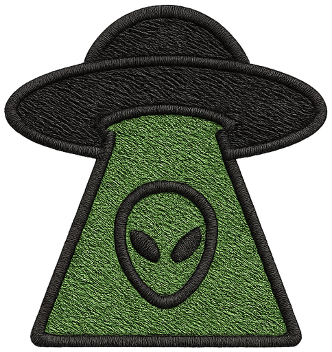
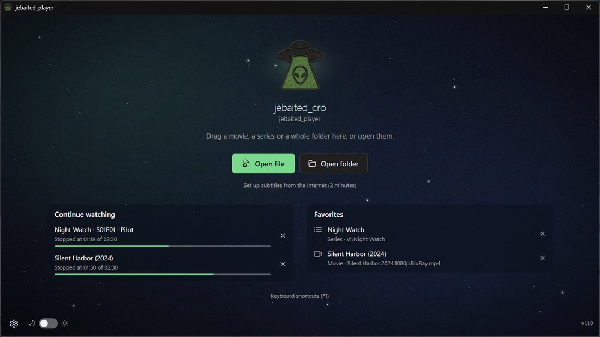

  

<h1 align="center">jebaited_player</h1>

  A lightweight video player for Windows that finds subtitles on the internet, checks that they belong to your video and syncs them to the speech.

  

## User manual · Benutzerhandbuch · Korisnički priručnik

| | |
|---|---|
| 🇬🇧 **English** | [README_EN.md](README_EN.md) |
| 🇩🇪 **Deutsch** | [README_DE.md](README_DE.md) |
| 🇭🇷 **Hrvatski** | [README_HR.md](README_HR.md) |

Each manual has three parts: **Quick Start**, **Basic Guide** and **Advanced Guide**.

## Download

[Latest release](https://github.com/jebaitedcro7/jebaited_player/releases/latest) → **`JebaitedPlayer-win-Setup.exe`** (Windows 10/11, 64-bit, no administrator rights needed). A portable ZIP is in the same release.

Also in the **[Microsoft Store](https://apps.microsoft.com/detail/9NP4GF0Q40JL)** (works with Smart App Control; updated by the Store, can be a version or two behind GitHub).

The interface is available in English, Deutsch, Hrvatski, Bosanski, Srpski (latinica) and Slovenščina; you choose the language on first start and can change it any time in Settings.

The GitHub releases are **not code signed**, so Windows SmartScreen may warn, and **Smart App Control** blocks them (it checks every program and library when it runs, not only the installer). To use the GitHub version, Smart App Control has to be turned off (Windows Security → App & browser control → Smart App Control settings). With Smart App Control on, use the Microsoft Store version, which is signed by Microsoft. See the [code signing policy](CODE_SIGNING.md).

## Changes

Every version with its date, new features, improvements, fixes and known issues: [CHANGELOG.md](CHANGELOG.md) · [Deutsch](CHANGELOG_DE.md) · [Hrvatski](CHANGELOG_HR.md), and on the [releases page](https://github.com/jebaitedcro7/jebaited_player/releases). The same history is in the player: click the version number on the home screen. Versions follow [Semantic Versioning](https://semver.org).

## License

[GPL-3.0](LICENSE). Third-party components: [THIRD_PARTY_NOTICES.md](THIRD_PARTY_NOTICES.md).

[Code signing policy](CODE_SIGNING.md) · [Privacy policy](PRIVACY.md)
