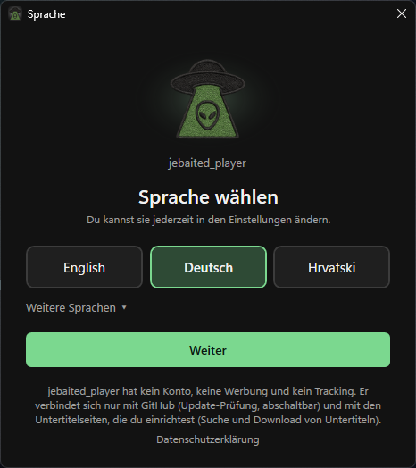
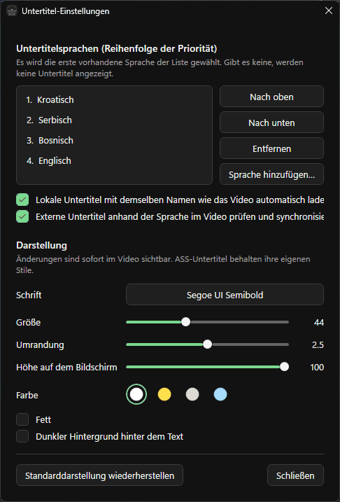
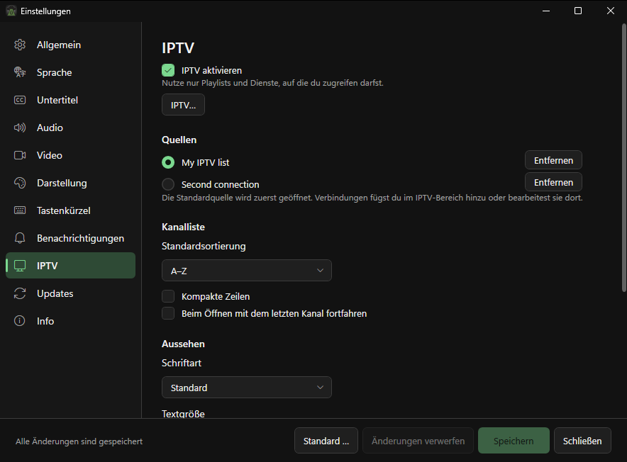
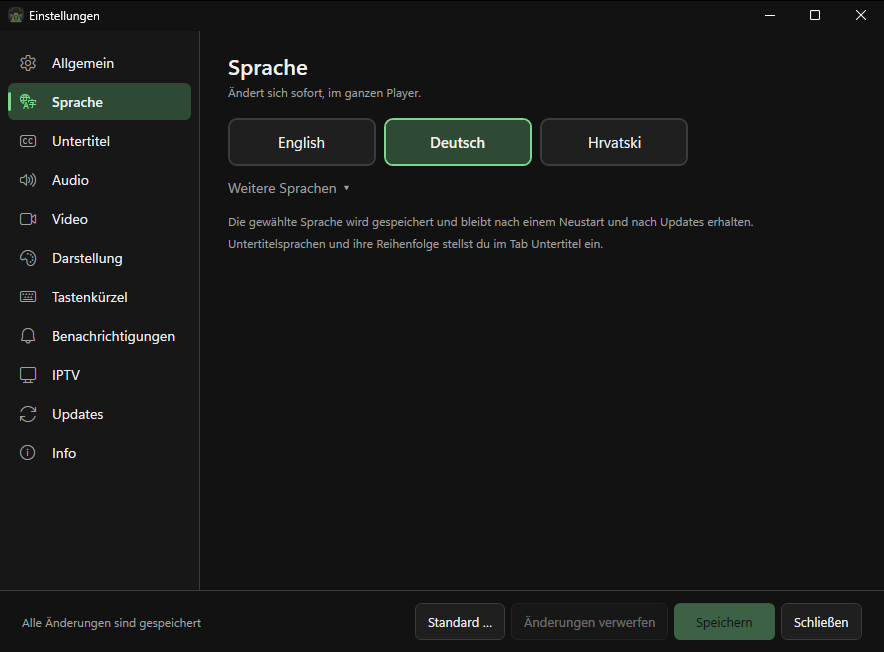
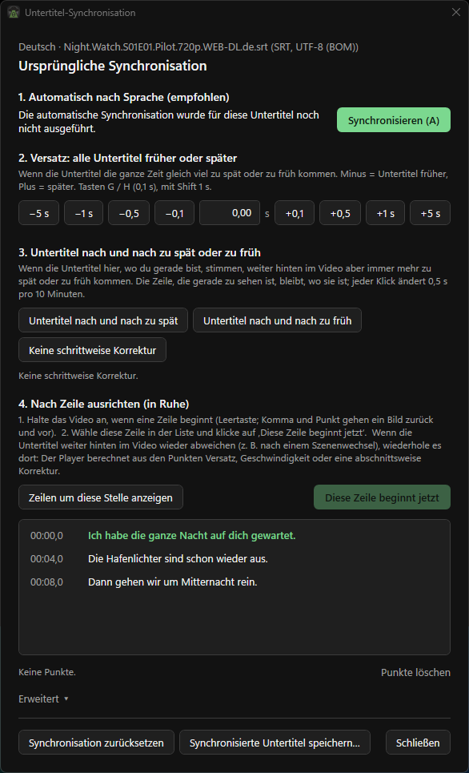

<p align="center">
  
</p>

<h1 align="center">jebaited_player — Benutzerhandbuch</h1>

<p align="center">
  <a href="README_EN.md">English</a> · <b>Deutsch</b> · <a href="README_HR.md">Hrvatski</a>
</p>

jebaited_player ist ein leichter Videoplayer für Windows. Er spielt fast jedes Video ab, sucht Untertitel selbst im Internet, prüft, ob sie zu genau deinem Video gehören, und synchronisiert sie mit der Sprache.

**Inhalt**

- [Installation](#installation)
- [A. Schnellstart](#a-schnellstart)
- [B. Grundlagen](#b-grundlagen)
- [C. Fortgeschritten](#c-fortgeschritten)

---

## Installation

1. Öffne die [neueste Version](https://github.com/jebaitedcro7/jebaited_player/releases/latest) und lade **`JebaitedPlayer-win-Setup.exe`** herunter.
2. Starte die Datei. Die Installation dauert ein paar Sekunden und braucht keine Administratorrechte. Auf dem Desktop und im Startmenü erscheint die Verknüpfung **jebaited_player**.
3. Windows zeigt eventuell das blaue Fenster „Der Computer wurde durch Windows geschützt“, weil die App noch nicht digital signiert ist. Klicke auf **Weitere Informationen → Trotzdem ausführen**. Ist **Smart App Control** eingeschaltet, blockiert Windows das Installationsprogramm und das Programm (es prüft jedes Programm und jede Bibliothek beim Ausführen). Für die GitHub-Version schalte es aus: Windows-Sicherheit → App- & Browsersteuerung → Einstellungen für Smart App Control → Aus. Schaltest du es später wieder ein, blockiert Windows jebaited_player erneut, und bei nicht vollständig aktualisierten Windows-11-Versionen lässt es sich nur durch ein Zurücksetzen von Windows wieder einschalten. Bei eingeschaltetem Smart App Control nutze die Microsoft-Store-Version unten (von Microsoft signiert). Siehe [CODE_SIGNING.md](CODE_SIGNING.md).
4. Nach der Installation startet der Player und fragt nach der **Sprache**. English ist vorausgewählt, Deutsch und Hrvatski stehen daneben, die übrigen Sprachen findest du unter **Weitere Sprachen**. Wenn du nur auf **Continue** / **Weiter** klickst (oder das Fenster schließt), bleibt der Player auf Englisch. Die Sprache lässt sich jederzeit in den Einstellungen ändern.

<p align="center"></p>

Du brauchst Windows 10 oder 11 (64 Bit). Sonst muss nichts installiert werden (Download etwa 115 MB, hauptsächlich die Wiedergabe-Engine mit allen Codecs).

**Portable Version:** `JebaitedPlayer-win-Portable.zip` irgendwo entpacken und `jebaited_player.exe` starten. Sie ändert nichts in Windows (kein Eintrag unter „Öffnen mit“); Updates funktionieren auch hier.

**Microsoft Store:** jebaited_player gibt es auch im [Microsoft Store](https://apps.microsoft.com/detail/9NP4GF0Q40JL). Die Store-Version funktioniert mit Smart App Control, wird über den Store aktualisiert und kann ein oder zwei Versionen hinter GitHub liegen.

---

## A. Schnellstart

| Was | Wie |
|---|---|
| **Film öffnen** | Doppelklick auf die Datei, Datei ins Playerfenster ziehen oder **Datei öffnen** (Ctrl+O). |
| **Ganzen Ordner öffnen** | Serienordner ins Fenster ziehen oder **Ordner öffnen** (Ctrl+Shift+O). Der Player erstellt die Folgenliste und macht dort weiter, wo du aufgehört hast. |
| **Untertitel finden** | Untertitel neben dem Video werden automatisch geladen. Untertitel aus dem Internet: einmal ein kostenloses Konto einrichten (die Anleitung öffnet sich beim ersten Start), danach sucht der Player selbst. Manuelle Suche: **Ctrl+F**. |
| **Untertitelsprache ändern** | Unten rechts auf **CC** klicken und eine Untertitelspur wählen, oder **J** für die nächste. |
| **Synchronisation anpassen** | Meist automatisch. Kommen die Untertitel zu früh oder zu spät: **G** (früher) / **H** (später) in Schritten von 0,1 s; **A** synchronisiert erneut nach der Sprache. |
| **Vollbild** | **F** oder Doppelklick auf das Bild; **Esc** zum Beenden. |

---

## B. Grundlagen

### Startbildschirm

<p align="center"></p>

- Die **Seitenleiste** links (Symbole; sie wird unter der Maus breiter und zeigt die Namen): **Datei öffnen**, **Ordner öffnen**, **Untertitelsuche**, **IPTV** und **Radio**. Du kannst Dateien oder Ordner auch ins Fenster ziehen.
- **Weiterschauen** zeigt die letzten Videos mit der Stelle, an der du aufgehört hast. Klicken zum Fortsetzen, **×** entfernt einen Eintrag aus dem Verlauf.
- **Favoriten** enthält Filme und ganze Serien (Ctrl+D während der Wiedergabe). Eine Serie öffnet sich bei der Folge, bei der du gerade bist.
- **Tastenkürzel (F1)** zeigt alle Tastenkürzel.
- Unten links: das **Zahnrad** öffnet die Einstellungen, der **Schalter** wechselt zwischen dunklem und hellem Design. Unten rechts: die **Version** — ein Klick darauf öffnet den [Update-Verlauf](#update-verlauf).

### Wiedergabe-Steuerung

<p align="center"></p>

Die Steuerung erscheint, wenn du die Maus bewegst, und verschwindet während der Wiedergabe (die Zeit stellst du unter Einstellungen → Darstellung ein). Alles Weitere ist im Menü: **Rechtsklick** auf das Bild.

| Element | Funktion |
|---|---|
| ⌂ Startseite (oben links) | Zurück zum Startbildschirm, ohne den Player zu schließen. Musik und Radio laufen weiter und der Startbildschirm zeigt eine Wiedergabeleiste (Titel, Quelle, Play/Pause, Zurück/Weiter, Lautstärke); ein Video wird geschlossen und die Position gespeichert, damit du später weitermachen kannst. Erscheint und verschwindet zusammen mit der übrigen Steuerung. |
| Wiedergabe / Pause | Leertaste oder K, oder Klick auf das Bild |
| Zeitleiste | Irgendwo klicken springt sofort dorthin, oder ziehen. Eine Blase zeigt die Zeit unter der Maus. ← / → springen 5 s, Ctrl+← / → 30 s (einstellbar unter Einstellungen → Allgemein); , / . ein Bild zurück / vor |
| Lautstärke | ↑ / ↓ oder Mausrad; M schaltet den Ton aus |
| ♡ | Zu Favoriten hinzufügen / entfernen (Ctrl+D) |
| ☰ | Folgenliste (L) |
| CC | Untertitel-Menü |
| Öffnen | Datei öffnen (Ctrl+O) |
| ⤢ | Vollbild (F) |

Öffnest du ein Video, das du schon angefangen hast, fragt der Player **Weiterschauen?** (Enter = fortsetzen, Pos1 = von vorne). Unter Einstellungen → Allgemein kannst du stattdessen immer fortsetzen oder immer von vorne beginnen lassen.

### Folgenliste

<p align="center"></p>

- Beim Öffnen eines Ordners oder einer einzelnen Folge entsteht eine Liste aller Folgen, gruppiert nach Serie und Staffel. Sample-Dateien werden übersprungen.
- **N** / **P** nächste / vorherige Folge, **L** blendet die Liste ein oder aus.
- Die aktuelle Folge ist grün; ein Häkchen bedeutet angesehen (ab 95 %). Rechtsklick auf eine Folge markiert sie als angesehen oder nicht angesehen.
- Am Ende einer Folge bietet eine Karte die nächste an und startet sie nach einem Countdown (einstellbar unter Einstellungen → Allgemein → Serien, oder abschaltbar).

### Untertitel

Die Schaltfläche **CC** (oder Rechtsklick → **Untertitel**) öffnet das Untertitel-Menü:

- die Liste der Untertitel (im Video eingebettet und Dateien daneben) und **Keine Untertitel**;
- **Untertitel im Internet suchen…** (Ctrl+F) und **Untertitel aus Datei laden…** (Ctrl+T);
- **Zeichenkodierung** für Dateien mit falschen Zeichen;
- **Nach Sprache synchronisieren** (A), **Untertitel-Synchronisation…**, **Ursprüngliche Synchronisation wiederherstellen** (Ctrl+Backspace), **Untertitel ausblenden** (V);
- **Untertitel-Einstellungen…** (öffnet Einstellungen → Untertitel), **Untertitel aus dem Internet einrichten…**, **Untertitelquellen (Schlüssel)…**.

Untertitel mit demselben Namen wie das Video (`Film.srt`, `Film.de.srt`, `Film.ger.srt`…) und Untertitel in MKV-Dateien werden automatisch geladen. Welche Sprache zuerst gewählt wird, legst du unter **Einstellungen → Untertitel → Untertitelsprachen (Reihenfolge der Priorität)** fest.

<p align="center"></p>

Im selben Tab stellst du die automatische Suche, die Zeichenkodierung alter Untertitel und das Aussehen ein: Schrift, Größe, Umrandung, Höhe auf dem Bildschirm, Farbe, Fett und einen dunklen Hintergrund hinter dem Text. Änderungen sind sofort im Video sichtbar (ASS-Untertitel behalten ihre eigenen Stile).

### Audio

- **Lautstärke:** ↑ / ↓, Mausrad oder Schieberegler; **M** schaltet den Ton aus.
- **Audiospur:** **B** wechselt zur nächsten, oder Rechtsklick → **Audio** und eine Spur wählen (Sprache, Format und Kanäle werden angezeigt). Die Wahl wird pro Video gespeichert.
- **Einstellungen → Audio:** bevorzugte Audiosprache, Ausgabegerät (auch eine eigene **Ausgabe für Musik und Radio**, z. B. ein virtuelles Kabel für Discord), Audio-Synchronisierung (z. B. für Bluetooth-Kopfhörer), Lautstärkeausgleich für leise Dialoge und ein 10-Band-Equalizer mit Voreinstellungen und eigener Einstellung.

### Mini-Player

- Rechtsklick → **Mini-Player** oder **Ctrl+M**: ein kleines Fenster im Winamp-Stil, das im Vordergrund bleibt. Die Musik läuft weiter; **Ctrl+M** führt zurück zum vollen Player.
- Grüne Anzeige mit Zeit (Klick: Restzeit) und echter L/R-Pegelanzeige, laufender Interpret und Titel, Suchleiste, Zurück / Abspielen / Pause / Stopp / Weiter, Öffnen, Lautstärke. **EQ** und **PL** öffnen darunter Equalizer und Wiedergabeliste.
- Die Leisten-Taste macht daraus eine schmale Leiste; Ecke ziehen, Ctrl + Mausrad oder Ctrl + / − ändert die Größe. Position und Größe werden gespeichert.
- Ein einzelnes Lied spielt das ganze Album (alle Lieder im Ordner) nacheinander ohne Countdown.
- Musik öffnet den Mini-Player, ein Film oder eine Serie den vollen Player (abschaltbar unter Einstellungen → Darstellung). Der Mini-Player öffnet sich immer dort, wo du ihn gelassen hast.
- Rechtsklick auf den Mini-Player (oder Einstellungen → Darstellung): sechs Anzeigeschriften und vier VU-Meter-Stile (Balken, LED-Segmente, dünne Linien mit Spitze, aus).
- Filme und Serien haben einen eigenen Equalizer, Musik und Radio einen eigenen (Einstellungen → Audio: wählen, welcher bearbeitet wird).
- **Fünf Looks** (Rechtsklick → **Aussehen** oder **Einstellungen → Aussehen → Mini-Player**, wo jeder Look eine Vorschau hat und die Änderung sofort gilt): klassisches Winamp, Karte, schmale Leiste, Seitenleiste und UFO-Display. Alle haben dieselben Tasten und Funktionen, deine Wahl wird gespeichert. Die Looks Karte und Seitenleiste (und der Startbildschirm) zeigen das **Albumcover** des Titels (in die Datei eingebettet oder ein cover/folder-Bild daneben); ohne Cover erscheint das UFO-Logo.
- Das **Mausrad** ändert die Lautstärke um 5 % pro Raststufe überall auf dem Player (Video, Bedienleiste, Startbildschirm und der ganze Mini-Player), zwischen 0 und 100 %. Listen, die scrollen können (Playlist, Radiosender …), scrollen weiterhin, und **Strg + Mausrad** ändert die Größe des Mini-Players.
- Der Titel läuft in einer Endlosschleife und zeigt standardmäßig nur **Interpret und Titel**. Rechtsklick auf den Titel: Album, Jahr, Genre, Klangqualität oder Dateiname hinzufügen.
- Eine rote, sanft pulsierende **LIVE**-Anzeige erscheint, solange ein Radiosender läuft (alle Looks, voller Player und Startbildschirm).
- **Minimieren** (Taste oder Rechtsklick → In die Taskleiste minimieren) legt den Player in die Taskleiste, die Musik läuft weiter; das ist etwas anderes als **Mini-Player** und Schließen. Der Mini-Player und alle anderen Fenster (Equalizer, Radio, Discord …) bleiben immer ganz im sichtbaren Bildschirm, über der Taskleiste, auch mit mehreren Monitoren.
- Beim Start öffnet sich nur ein Fenster: der Mini-Player, wenn er deine letzte Ansicht war (oder wenn du eine Musikdatei öffnest), sonst der volle Player. Endet ein Start einmal ohne sichtbares Fenster, holt der Player das Hauptfenster selbst zurück, und der nächste Start öffnet es normal in der Bildschirmmitte.

### Radio

- **Ctrl+R**, Rechtsklick → **Radio …** oder die Quellenanzeige im Mini-Player: Sender nach Name, Genre und Land suchen (kostenloses Verzeichnis Radio Browser), mit ▶ (oder Klick auf den Namen) anhören, der Stern speichert ihn in den **Favoriten**. Auch jede Stream-URL (http/https, auch .m3u/.pls) funktioniert.
- Sender laufen im Mini-Player mit dem Musik-Equalizer, gekennzeichnet mit **RADIO** und **LIVE**, mit dem aktuellen Titel, wenn der Sender ihn sendet. Radio erscheint nicht unter „Weiterschauen“.
- **Stopp** hält den Sender wirklich an (er bleibt im Mini-Player angezeigt); **Wiedergabe** oder Leertaste verbindet neu, live. Pause → Wiedergabe geht ebenfalls live weiter, und Live-Radio lässt sich nicht zurückspulen.

### IPTV

- Klicke in der Seitenleiste des Startbildschirms auf **IPTV** (oder Rechtsklick auf das Video → **IPTV…**). Das Panel öffnet sich links vom Video. **Verbindung hinzufügen**: ein **Xtream-Codes**-Konto (Server, Benutzername, Passwort), ein **M3U/M3U8**-Link oder eine M3U-Datei; **Verbindung testen** prüft sie einmal (keine wiederholten Anmeldungen). Du kannst mehrere Verbindungen anlegen und jederzeit bearbeiten, aktualisieren oder entfernen.
- Kategorien (mit Flaggen und Symbolen) | Kanäle mit Logo, aktueller Sendung und Fortschrittsleiste, **★** für Favoriten; **Suche**, **Sortierung** (A–Z, Z–A, Original, eigene Reihenfolge: Rechtsklick auf einen Kanal → nach oben/unten), **Zuletzt gesehen**, Kanal oder ganze Kategorie ausblenden (Rechtsklick; ⋯ → *Ausgeblendete Sender anzeigen* holt sie zurück). Doppelklick oder Enter spielt einen Kanal im Hauptplayer ab; **F** oder Doppelklick auf das Bild ist Vollbild; ein Klick auf das Bild pausiert Live-TV nicht (nutze die Pause-Taste). **Stopp** im Player auf dem Startbildschirm beendet das TV und schließt das Panel.
- Der Programmführer zeigt *Jetzt* und *Danach*, eine Zeitleiste pro Tag (XMLTV oder der eigene Führer des Dienstes) und sagt es, wenn es keine Daten gibt.
- ⋯ → **Aussehen**: Schriftart, Textgröße, Hervorhebungsfarbe und Hintergrund nur für das IPTV-Panel. Ziehe den rechten Rand des Panels und die Trennlinie zwischen Kategorien und Kanälen auf die gewünschte Breite; sie wird gespeichert. ⋯ → Einstellungen exportieren/importieren (Favoriten, Reihenfolge, Ausgeblendetes – nie Passwörter).
- Dein Passwort wird **verschlüsselt** (DPAPI) gespeichert und nie angezeigt, protokolliert oder exportiert. Bietet der Server nur einfaches **HTTP**, sind Anmeldung und Stream nicht verschlüsselt, und der Player warnt davor. Der Player bringt **keine Kanäle oder Playlists** mit: Nutze nur Dienste, die du nutzen darfst. Das Modul schaltest du unter **Einstellungen → IPTV** aus; dort sind alle IPTV-Einstellungen in einem Tab: deine Verbindungen und die Standardverbindung, Standardsortierung, kompakte Zeilen, letzten Kanal fortsetzen sowie Schriftart, Textgröße und Farben. Änderungen gelten auch für ein geöffnetes IPTV-Panel.

<p align="center"></p>

### Spotify

- **Strg+Umschalt+S**, Rechtsklick → **Spotify …** oder die Quellenanzeige im Mini-Player. jebaited_player ist eine Fernbedienung für deine Spotify-App: Die Musik läuft in Spotify (Computer, Handy oder Lautsprecher), der Player zeigt den Song mit Cover und steuert ihn. Zum Steuern braucht man **Spotify Premium**.
- Spotify erlaubt höchstens 5 Nutzer pro Entwickler-App, daher verbindest du dich mit **deiner eigenen kostenlosen App**: Das Fenster zeigt die Schritte (App auf developer.spotify.com erstellen, die angezeigte Weiterleitungs-URI eintragen, Client ID einfügen), dann **Bei Spotify anmelden** im Browser.
- Wiedergabe, Pause, Weiter, Spulen und Lautstärke, deine **Playlists**, **gespeicherten Songs**, **Suche** und **Geräteauswahl**. Solange Spotify die Quelle ist, zeigt der Mini-Player **SPOTIFY** und seine Tasten steuern Spotify; eine Datei oder ein Sender schaltet zurück.
- Spotify-Ton läuft nie durch den Player (kein Equalizer) und wird nirgendwohin weitergeleitet.

### YouTube Music

- **Strg+Umschalt+Y**, Rechtsklick → **YouTube Music …** oder die Quellenanzeige im Mini-Player. Füge einen Link von YouTube oder YouTube Music ein (Song oder Playlist) und drücke **Link abspielen**; das geht ohne Konto und ohne Schlüssel.
- Die **Suche** braucht deinen eigenen kostenlosen YouTube-API-Schlüssel: Das Fenster zeigt die Schritte (Google-Cloud-Konsole → Projekt → „YouTube Data API v3“ aktivieren → API-Schlüssel erstellen). Google erlaubt etwa 100 Suchen pro Tag und Schlüssel. Mit **API-Schlüssel …** neben der Suche änderst oder entfernst du den Schlüssel.
- Der offizielle YouTube-Player läuft im Fenster und muss sichtbar bleiben (YouTube-Regeln): keine Wiedergabe im Hintergrund, kein Werbeblocker; Minimieren pausiert ihn. Solange YouTube die Quelle ist, zeigt der Mini-Player **YOUTUBE** und seine Tasten steuern YouTube; eine Datei oder ein Sender schaltet zurück.
- YouTube-Ton läuft nicht über den Equalizer des Players.

### Discord-Bot

- **Strg+Umschalt+D**, Rechtsklick → **Discord-Bot …** oder die Headset-Taste im Mini-Player. Dein eigener Bot betritt einen Sprachkanal auf deinem Discord-Server und spielt, was der Player spielt: **nur lokale Musik und Radio**. Filme, YouTube Music und Spotify werden nie gesendet (solange ein Film läuft oder YouTube geöffnet ist, sendet der Bot Stille).
- Den Bot erstellst du einmal, kostenlos; das Fenster zeigt die Schritte: Discord Developer Portal → neue Anwendung → Install Link auf None und Public Bot aus → URL Generator mit den Berechtigungen View Channels, Connect und Speak → Bot auf deinen Server einladen → Reset Token. Füge den Token im Fenster ein; er wird verschlüsselt nur auf deinem Computer gespeichert.
- **Meinem Kanal beitreten** bringt den Bot in den Kanal, in dem du bist, oder wähle einen Kanal aus der Liste. Die Headset-Taste im Mini-Player ist grün, solange der Bot Musik sendet. Fehlt dem Bot in einem Kanal eine Berechtigung, zeigt das Fenster, welche und wo man sie erlaubt.
- Discord hört, was der Player spielt. Standardmäßig gilt die Lautstärke des Players auch für Discord; im Discord-Fenster kannst du Discord eine **eigene Lautstärke** geben, dann wird es im Kanal nicht leiser, wenn du den Player für dich leiser stellst. Ein stummgeschalteter Player (oder Lautstärke 0) sendet immer Stille. Der Ton ist Ende-zu-Ende-verschlüsselt (Discord DAVE). Der Bot funktioniert nur auf Servern, auf die du ihn einlädst, nicht in privaten Anrufen. Benötigt Windows 11 oder Windows 10 Build 20348 oder neuer.

### Torlink (online suchen, nur GitHub-Version)

- Optional und **standardmäßig aus**. Einschalten unter **Einstellungen → Torlink**. Nachdem du einen Hinweis akzeptiert hast, lädt der Player ein geprüftes Paket (Node.js + Torlink, ca. 40 MB, SHA-256 geprüft) aus den Releases dieses Repositories. Es ist **nicht Teil der Microsoft-Store-Version**.
- Danach erscheint in der Seitenleiste des Startbildschirms ein weiterer Eintrag, **Filme und Serien online suchen**. Er öffnet die Torlink-Seite: eine Suche über mehrere öffentliche Indizes (Filme, Serien, Anime, Spiele), Ergebnisse mit Größe, Seedern und Quelle (sortieren und filtern) und eine Download-Verwaltung (aktiv, Warteschlange, abgeschlossen, fehlgeschlagen; pausieren, fortsetzen, abbrechen, Ordner öffnen, abspielen). **Start** (oder Esc / Alt+←) führt zurück zum Startbildschirm des Players, die Downloads laufen weiter; **Strg+Umschalt+T** öffnet und schließt die Seite.
- Torlink ist das Open-Source-Projekt [baairon/torlink](https://github.com/baairon/torlink) (MIT), unverändert verwendet. Der Player spricht über dessen lokale Schnittstelle mit ihm und startet es nur, solange es gebraucht wird. Einstellungen: Download-Ordner, gleichzeitige Downloads, playlist.m3u, zusätzliche Tracker, Netzwerkschnittstelle (VPN) und Teilen nach dem Download (**standardmäßig aus**). Updates nur auf deinen Klick, aus unserem geprüften Paket, mit automatischem Zurücksetzen.
- **Deine Verantwortung:** BitTorrent zeigt anderen Nutzern deine IP-Adresse. Lade nur herunter und teile nur, was du darfst. Der Player hostet oder prüft keine Inhalte. Siehe [PRIVACY.md](PRIVACY.md).

### Sicherung und Übertragung

Einstellungen → Allgemein → **Sicherung und Übertragung**: Einstellungen und Wiedergabeverlauf werden einmal täglich und vor jedem Update automatisch kopiert (die letzten 7 bleiben auf deinem Computer). **Einstellungen exportieren** speichert sie in einer Datei (ohne Passwörter, Schlüssel für Untertitelseiten und Fensterposition), **Einstellungen importieren** lädt sie wieder, auch auf einem anderen Computer.

**Speichern**, **Änderungen verwerfen** und **Standard …** unten in den Einstellungen: Änderungen gelten sofort, Speichern behält sie, Änderungen verwerfen kehrt zum letzten Speichern zurück, und Standard … setzt den aktuellen Tab oder alle Einstellungen zurück (Sprache, Schlüssel, Lautstärke und Fensterpositionen bleiben).

### Sprache der App

<p align="center"></p>

Öffne die Einstellungen (Zahnrad auf dem Startbildschirm oder Rechtsklick → **Einstellungen…**) und den Tab **Sprache**. Auf English, Deutsch oder Hrvatski klicken; Bosanski, Srpski, Slovenščina, Español, Français, Italiano, Português und Русский stehen unter **Weitere Sprachen**. Der ganze Player wechselt sofort, auch offene Fenster, Menüs und Meldungen. Ein Neustart ist nicht nötig, und die Sprache bleibt nach dem Schließen, einem Neustart des Computers und einem Update erhalten.

### Dunkles / helles Design

<p align="center"></p>

Mit dem Schalter unten links auf dem Startbildschirm (Mond = dunkel, Sonne = hell) oder unter **Einstellungen → Darstellung → Design**. Die Änderung gilt sofort und wird gespeichert. Dunkel ist Standard. Die Steuerung über dem Video bleibt immer dunkel, damit sie auf dem Bild gut sichtbar ist; Video und Untertitel werden vom Design nicht verändert.

### Akzentfarbe

Unter **Einstellungen → Darstellung → Akzentfarbe** wählst du die Farbe von Schaltflächen, Reglern, markierten Einträgen und dem Mini-Player: acht fertige Farben (Grün ist Standard) oder **Eigene Farbe …** (Farbton, Sättigung und Helligkeit oder #RRGGBB eingeben, mit Live-Vorschau; Abbrechen stellt die vorherige Farbe wieder her). Der Hintergrund bleibt das dunkle oder helle Design, und in jedem Design wird die Farbe bei Bedarf etwas aufgehellt oder abgedunkelt, damit Text lesbar bleibt. Die Änderung ist sofort sichtbar; **Speichern**, **Änderungen verwerfen** und **Standard** funktionieren wie bei allen anderen Einstellungen.

### Verlauf und Favoriten

- Die Position wird alle paar Sekunden, beim Pausieren, beim Klick auf **Startseite** und beim Schließen des Players gespeichert.
- **Weiterschauen** zeigt die letzten Videos (× entfernt eines aus dem Verlauf).
- **Favoriten:** Ctrl+D fügt einen Film oder die ganze Serie der aktuellen Folge hinzu; × auf dem Startbildschirm entfernt ihn.
- **Als Nächstes:** Die nächste Folge einer Serie, die du schaust, erscheint von selbst (auch über Staffeln hinweg); Rechtsklick auf ein Video oder einen Eintrag in „Weiterschauen“ → **Zu „Als Nächstes“ hinzufügen**; ▲ ▼ ändern die Reihenfolge, × entfernt. Ein Eintrag verschwindet, sobald er angesehen ist.

### Einstellungen

Die Einstellungen sind in Tabs aufgeteilt. Jede Änderung gilt sofort (auch für das laufende Video). **Speichern** behält sie, **Änderungen verwerfen** geht zum zuletzt gespeicherten Stand zurück, und beim Schließen mit ungespeicherten Änderungen kommt die Frage: Speichern, Änderungen verwerfen oder Abbrechen.

| Tab | Was du einstellst |
|---|---|
| Allgemein | Fortsetzen eines begonnenen Videos (fragen / fortsetzen / von vorne), Sprungweite der Pfeiltasten, Videos im Vollbild öffnen, Player im Vordergrund halten, Serien (nächste Folge, Countdown), Screenshot-Ordner, „Öffnen mit“ und Standard-Player |
| Sprache | Sprache der App |
| Untertitel | Untertitelsprachen und ihre Reihenfolge, automatisches Laden und Suchen, Quellen im Internet, Zeichenkodierung alter Untertitel, Aussehen, Synchronisierung |
| Audio | Lautstärke, Lautstärkeausgleich, Equalizer, bevorzugte Audiosprache, Ausgabegerät, Ausgabe für Musik und Radio, Audio-Synchronisierung |
| Video | Bildqualität, Hardware-Dekodierung, Standard-Seitenverhältnis, HDR |
| Darstellung | Dunkles / helles Design, Akzentfarbe, Hintergrund des Startbildschirms (Standard oder eigenes Bild: Füllen, Einpassen, Zentriert), wie lange die Steuerung sichtbar bleibt, Oberfläche über die GPU darstellen, Uhrzeit, Datum und Wetter auf dem Startbildschirm (eine Stadt deiner Wahl, von Open-Meteo; Schriftart, Größe und Position jedes Elements, Vorschau und Wetterdetails wie gefühlte Temperatur, Min/Max, Regen, Wind, Luftfeuchtigkeit, UV, Sonnenauf- und -untergang, nächste Stunden und Tage) |
| Tastenkürzel | Tasten für jede Aktion, bis zu zwei pro Aktion (siehe [Tastenkürzel](#tastenkürzel)) |
| Benachrichtigungen | Neuigkeiten, Tipps und neue Versionen, mit Status gelesen / ungelesen / verworfen (siehe [Benachrichtigungen](#benachrichtigungen)) |
| Torlink | Nur in der GitHub-Version (siehe [Torlink](#torlink-online-suchen-nur-github-version)) |
| IPTV | Modul ein- oder ausschalten, Verbindungen und die Standardverbindung, Standardsortierung, kompakte Zeilen, letzten Kanal fortsetzen, Schriftart, Textgröße und Farben (siehe [IPTV](#iptv)) |
| Updates | Version, jetzt prüfen, automatischer Download, Neuerungen, Update-Verlauf |
| Info | Version, Lizenz, verwendete Technologien, Handbuch, Datenschutz, Richtlinie zur Code-Signierung, Fehlerberichte (ohne persönliche Daten auf deinem Computer gespeichert; du sendest sie selbst über GitHub) |

### Benachrichtigungen

- Auf dem Startbildschirm zeigt eine kleine Karte Neuigkeiten zum Player, einen nützlichen Tipp oder eine neue Version. Sie sitzt über der Wiedergabeleiste, wenn etwas läuft (und verdeckt sie nie), und tief, direkt über der Versionsnummer, wenn nichts läuft; ein dünner Pfeil zeigt auf die Versionsnummer. Erscheint oder verschwindet die Wiedergabeleiste, bewegt sich die Karte sanft.
- **Mehr lesen** (oder ein Klick auf die Karte) öffnet die Details; **✕** verwirft die Karte. Eine Karte wird höchstens dreimal angezeigt, und nachdem du reagiert hast, erscheinen in derselben Sitzung nur noch wichtige Hinweise und neue Versionen.
- Die Taste **Benachrichtigungen** unten links auf dem Startbildschirm (mit der Zahl der ungelesenen) und **Einstellungen → Benachrichtigungen** listen alles auf, auch gelesene und verworfene. **Alle als gelesen markieren** setzt den Ungelesen-Status zurück.
- Neuigkeiten und Tipps sind Teil des Players selbst (in allen 11 Sprachen); die einzige weitere Quelle ist die Update-Prüfung auf GitHub, die der Player ohnehin macht. Es wird nichts Neues ins Internet gesendet, der Status liegt in `notifications.json` neben deinen Einstellungen.

### Update-Verlauf

<p align="center"></p>

Klicke unten rechts auf dem Startbildschirm auf die Versionsnummer und wähle **Update-Verlauf anzeigen**. Jede Version steht mit Datum, neuen Funktionen, Verbesserungen, Fehlerbehebungen und bekannten Problemen da. Der Verlauf ist im Player enthalten und funktioniert ohne Internet; online erscheinen neuere Versionen von GitHub oben. Derselbe Verlauf steht in [CHANGELOG_DE.md](CHANGELOG_DE.md) und auf der [Release-Seite](https://github.com/jebaitedcro7/jebaited_player/releases).

---

## C. Fortgeschritten

### Automatische Untertitelsuche

Hat ein Video keine Untertitel in der ersten Sprache deiner Liste, sucht der Player selbst im Internet. Dafür braucht er mindestens eine Quelle mit deinem kostenlosen Konto; die kurze Anleitung (Rechtsklick → Untertitel → **Untertitel aus dem Internet einrichten…**) öffnet die Registrierungsseite, prüft deine Daten und speichert sie.

| Quelle | Was du brauchst | Hinweis |
|---|---|---|
| OpenSubtitles.com (empfohlen) | Kostenloses Konto und kostenloser API-Schlüssel | Die einzige Quelle, die die genaue Version am Datei-Fingerabdruck erkennt |
| SubDL.com | Kostenloser API-Schlüssel | Zusätzliche Untertitel, wenn OpenSubtitles keine hat |
| Titlovi.com | Konto | Große kroatische Datenbank; aus, bis du sie einschaltest |

- Untertitel werden nur dann automatisch geladen, wenn sie zur **gleichen Version** gehören (Datei-Fingerabdruck) oder die Prüfung anhand der Sprache sie bestätigt. Sonst sagt dir der Player Bescheid und du wählst selbst (Ctrl+F).
- Heruntergeladene Untertitel werden neben dem Video gespeichert (z. B. `Film.de.srt`) und laden beim nächsten Mal ohne Internet.
- Ein kostenloses OpenSubtitles-Konto hat ein tägliches Download-Limit. Der Player merkt sich heruntergeladene Untertitel und lädt dieselben nie zweimal herunter.
- Passwörter und Schlüssel werden verschlüsselt gespeichert (Windows DPAPI) und nur an die Quelle gesendet, zu der sie gehören.

### Untertitel manuell herunterladen

<p align="center"></p>

**Ctrl+F** (oder CC → **Untertitel im Internet suchen…**) öffnet die Suche. Titel, Jahr, Staffel und Folge werden aus dem Dateinamen übernommen; korrigiere sie bei Bedarf und klicke auf **Suchen**. Die Sprachmarke zeigt, wie sicher die Zuordnung ist: **grün** = gleiche Version, **gelb** = wahrscheinlich, **grau** = unsicher. **Laden** lädt die Untertitel herunter, prüft sie und lädt sie.

### Synchronisation

<p align="center"></p>

Öffnen mit CC → **Untertitel-Synchronisation…**. Oben steht die aktuelle Korrektur. Korrekturen werden pro Video und Untertiteldatei gespeichert; die Originaldatei wird nie verändert.

1. **Automatisch nach Sprache (empfohlen).** Beim Laden externer Text-Untertitel vergleicht der Player sie mit der Sprache im Video und korrigiert Versatz, Geschwindigkeit (z. B. Untertitel für 25 fps bei einem 23,976-fps-Video) und Sprünge bei einem anderen Schnitt. Übernommen wird nur ein geprüftes Ergebnis. Ist das Ergebnis nicht eindeutig, wird die Sprache noch einmal mit einem strengeren Sprachdetektor geprüft (er blendet mehr Musik und Geräusche aus) und das bessere Ergebnis behalten. Untertitel einer anderen Folge oder eines anderen Films lösen eine Warnung aus. Erneut starten mit **A** oder **Synchronisieren (A)**. Eingebettete Untertitel sind bereits synchron und werden nicht geprüft.
2. **Versatz – alle Untertitel früher oder später.** **G** / **H** verschieben um 0,1 s (Shift: 1 s, Ctrl: 10 ms), oder die Schaltflächen nutzen, oder einen genauen Wert in Sekunden eingeben und Enter drücken. Minus = früher.
3. **Untertitel nach und nach zu spät oder zu früh.** Wenn sie an der aktuellen Stelle stimmen, weiter hinten aber abweichen: Jeder Klick ändert 0,5 s pro 10 Minuten; die gerade sichtbare Zeile bleibt, wo sie ist.
4. **Nach Zeile ausrichten (am genauesten).** Halte an, wenn eine Zeile beginnt, klicke auf **Zeilen um diese Stelle anzeigen**, wähle die Zeile und klicke auf **Diese Zeile beginnt jetzt**. Bei Bedarf weiter hinten im Video wiederholen: Aus mehreren Punkten berechnet der Player Versatz, Geschwindigkeit oder eine abschnittsweise Korrektur.
5. **Erweitert ▾ → Geschwindigkeit für andere FPS.** Fertige Korrekturen für 25 ↔ 23,976 ↔ 24 fps oder ein Geschwindigkeitsfaktor (1,0000 = keine Korrektur). Nur verwenden, wenn die Untertitel für eine andere Bildrate erstellt wurden.
6. **Klassisch:** **Z** drücken, wenn du eine Zeile hörst, und **X**, wenn ihr Untertitel erscheint (zwei weit auseinanderliegende Punkte korrigieren auch die Geschwindigkeit).

**Synchronisation zurücksetzen** (Ctrl+Backspace) stellt die Untertitel wie in der Datei wieder her. **Synchronisierte Untertitel speichern…** speichert eine korrigierte Kopie (z. B. `Film.de.sync.srt`).

### Unterstützte Formate

| Typ | Formate |
|---|---|
| Video | MP4, MKV, AVI, MOV, WMV, FLV, WebM, MPEG/MPG, M4V, TS/MTS/M2TS, VOB, 3GP, OGV — H.264, HEVC, AV1, VP9, 4K und HDR, Hardware-Dekodierung |
| Audio | MP3, AAC, FLAC, WAV, OGG, Opus, AC3, DTS, E-AC3, M4A, WMA, MKA |
| Untertiteldateien | SRT, ASS/SSA, WebVTT, MicroDVD und SubViewer (.sub), VobSub (.sub + .idx), TTML/DFXP, PGS (.sup) |
| Eingebettete Untertitel | Text (SRT, ASS, WebVTT, MP4-Text) und bildbasiert (PGS, VobSub, DVB) |
| Zeichenkodierungen | UTF-8, UTF-16, Windows-1250/1251/1252, ISO-8859-2 — automatisch erkannt, im Untertitel-Menü änderbar |

Archive von Untertitelseiten: ZIP wird unterstützt, RAR noch nicht.

### Erweiterte Wiedergabe-Einstellungen

- **Wiedergabegeschwindigkeit** 0,5–2×: **+** / **−**, **Backspace** = normal, oder Rechtsklick → **Geschwindigkeit**.
- **Seitenverhältnis:** **O** oder Rechtsklick → **Seitenverhältnis** (Original, 16:9, 4:3, 1,85:1, 2,35:1, Bild füllen).
- **Screenshot:** **S** mit Untertiteln, **Shift+S** nur Bild; gespeichert als JPG in voller Videoauflösung.
- **Zeichenkodierung:** CC → Zeichenkodierung, wenn Buchstaben wie ä, ö, ü, ß, č, ć, ž falsch aussehen.
- **Standard-Player:** Einstellungen → Allgemein → Windows → **Als Standard-Player festlegen…**; die Windows-Einstellungen öffnen sich, dort auf „Als Standard festlegen“ klicken. Windows erlaubt Programmen nicht, das selbst zu tun.
- **Ein Fenster:** Eine Datei, die du öffnest, während der Player läuft, geht an den offenen Player; mehrere ausgewählte Dateien öffnen sich als eine Liste.
- **Oberfläche über die GPU darstellen:** standardmäßig aus (zuverlässiger); gilt nach einem Neustart. Video nutzt immer die GPU.
- **Bildqualität und Dekodierung:** Einstellungen → Video — ausgewogen (Standard), hohe Qualität (schärfere Skalierung, mehr GPU-Last) oder schnell (ältere Computer); die Hardware-Dekodierung lässt sich abschalten, wenn das Bild fehlerhaft ist.

### Tastenkürzel

Die Tasten änderst du unter **Einstellungen → Tastenkürzel**. Jede Aktion kann zwei Tasten haben: auf eine Taste klicken und die neue Kombination drücken (Esc bricht ab, Entf (Delete) entfernt die Taste). Nutzt schon eine andere Aktion die Taste, meldet der Player das, und ein zweiter Druck auf dieselbe Taste verschiebt sie hierher. **Standard** in einer Zeile stellt die Tasten dieser Aktion wieder her, **Standard** für den Tab alle Tasten. F1 und die Menüs zeigen immer deine tatsächlichen Tasten. Esc, Enter, Alt+Enter, Alt+F4 und die Medientasten der Tastatur haben eine feste Rolle und lassen sich nicht zuweisen. Die Tabelle zeigt die Standardtasten.

| Taste | Aktion |
|---|---|
| Leertaste / K | Wiedergabe / Pause |
| ← / → | Zurück / vor (5 s; die Sprungweite wird unter Einstellungen → Allgemein eingestellt) |
| Ctrl+← / Ctrl+→ | Zurück / vor, 6× länger (standardmäßig 30 s) |
| Home | Zum Anfang |
| ↑ / ↓ / Mausrad | Lautstärke |
| M | Ton aus / an |
| F / F11 / Doppelklick | Vollbild (Esc zum Beenden) |
| , / . | Bild zurück / vor |
| N / P / L | Nächste / vorherige Folge / Folgenliste |
| Ctrl+O / Ctrl+Shift+O | Video öffnen / Ordner öffnen |
| Ctrl+T / Ctrl+F | Untertitel aus Datei / aus dem Internet |
| V / J | Untertitel ein- oder ausblenden / nächste Untertitel |
| G / H | Untertitel früher / später (100 ms) |
| Ctrl+G / Ctrl+H | Untertitel früher / später (10 ms) |
| Shift+G / Shift+H | Untertitel früher / später (1 s) |
| Z, dann X | Nach Zeile synchronisieren |
| A | Nach Sprache synchronisieren |
| Ctrl+Backspace | Ursprüngliche Untertitel-Synchronisation wiederherstellen |
| B | Nächste Audiospur |
| + / Num + | Schnellere Wiedergabe |
| − / Num − | Langsamere Wiedergabe |
| Backspace | Normale Geschwindigkeit |
| O | Seitenverhältnis |
| S / Shift+S | Screenshot (mit / ohne Untertitel) |
| Ctrl+D | Zu Favoriten hinzufügen / entfernen |
| Ctrl+M | Mini-Player / zurück zum vollen Player |
| Ctrl+R | Radio |
| Ctrl+Shift+S | Spotify |
| Ctrl+Shift+Y | YouTube Music |
| Ctrl+Shift+D | Discord-Bot |
| Ctrl+Shift+T | Torlink (online suchen) |
| F1 | Alle Tastenkürzel |

### Updates und deine Daten

Der Player prüft 20 Sekunden nach dem Start und danach alle 12 Stunden auf GitHub, ob es eine neue Version gibt, lädt sie im Hintergrund herunter und **installiert sie beim Schließen des Players** — beim Anschauen wird nichts unterbrochen. Unter Einstellungen → Updates siehst du die Version, kannst sofort prüfen oder den automatischen Download abschalten.

Einstellungen (auch Sprache und Design), Verlauf, Schlüssel und Zwischenspeicher liegen in `%LOCALAPPDATA%\jebaited_player`, getrennt vom Programm, und bleiben bei Updates und Neuinstallationen erhalten. Falls die Einstellungsdatei einmal beschädigt ist, wird sie beiseitegelegt (`settings.corrupt-….json`) und die Einstellungen kommen aus der letzten automatischen Sicherung zurück.

Die Microsoft-Store-Version speichert ihre Daten in `%LOCALAPPDATA%\Packages\jebaitedplayer.jebaitedplayer_5g6w8vrmj8ate\LocalState\jebaited_player` und wird über den Store aktualisiert.

### Problemlösung

- **„Der Computer wurde durch Windows geschützt“** — die App ist noch nicht signiert: Weitere Informationen → Trotzdem ausführen. Smart App Control: Für die GitHub-Version muss es ausgeschaltet sein (siehe [Installation](#installation)); die Microsoft-Store-Version funktioniert mit eingeschaltetem Smart App Control.
- **Es werden keine Untertitel gefunden** — prüfe, ob eine Quelle eingerichtet ist (Einstellungen → Untertitel → Untertitelquellen (Schlüssel)). Ist das Tageslimit aufgebraucht, warte bis morgen oder füge SubDL hinzu. Manuell suchen kannst du immer mit **Ctrl+F** und dort Titel, Staffel und Folge korrigieren.
- **Untertitel sind falsch oder passen nicht** — meldet der Player, dass sie nicht zur Sprache passen, gehören sie wahrscheinlich zu einer anderen Folge oder Version: Ctrl+F und andere wählen. Ctrl+Backspace macht die manuelle Synchronisation rückgängig.
- **Seltsame Zeichen statt Buchstaben** — CC → Zeichenkodierung → Windows-1252, Windows-1250 oder ISO-8859-2. Passiert das bei den meisten deiner Untertitel, stelle es einmal unter Einstellungen → Untertitel → Zeichenkodierung alter Untertitel ein.
- **Weiße oder leere Fenster** — prüfe, dass Einstellungen → Darstellung → Erweitert → „Oberfläche über die GPU darstellen“ aus ist (Standard).
- **Ein Video wird nicht abgespielt** — der Grund steht im Protokoll: `%LOCALAPPDATA%\jebaited_player\logs\app.log`. Öffne ein Issue auf GitHub und hänge es an (es enthält keine Passwörter oder Schlüssel).
- **Deinstallieren** — Windows-Einstellungen → Apps → jebaited_player → Deinstallieren. Auch „Öffnen mit“ wird entfernt. Einstellungen und Verlauf bleiben in `%LOCALAPPDATA%\jebaited_player`; lösche den Ordner, wenn du sie nicht brauchst.

### Datenschutz

- Ins Internet gehen nur: Untertitelsuchen (Titel, Jahr, Staffel/Folge, Datei-Fingerabdruck) an die Quellen, die du eingerichtet hast, die Anmeldung bei diesen Quellen mit deinem Konto und die Update-Prüfung auf GitHub.
- Passwörter und Schlüssel sind verschlüsselt (Windows DPAPI, an dein Windows-Konto gebunden) und werden nie ins Protokoll geschrieben.
- Benachrichtigungen (Neuigkeiten, Tipps, neue Versionen) sind Teil des Players und brauchen keine zusätzliche Internetverbindung.
- Keine Statistiken, kein Tracking. Alle Details: [PRIVACY.md](PRIVACY.md).

### Übersetzungen

Die Oberfläche gibt es in 11 Sprachen: English, Deutsch, Hrvatski, Bosanski, Srpski (latinica), Slovenščina, Español, Français, Italiano, Português und Русский (die letzten fünf wurden ohne Prüfung durch Muttersprachler übersetzt; Verbesserungen sind willkommen). Jede Sprache ist eine Datei in `src/JebaitedPlayer.Localization/Languages/`; eine neue Sprache ist eine Kopie von `en.json` mit der Übersetzung. Verbesserungen sind willkommen (Issue oder Pull Request).

### Für Entwickler

```powershell
# .NET 10 SDK; libmpv-2.dll wird vom Skript heruntergeladen und geprüft (SHA256):
.\tools\get-libmpv.ps1
dotnet build jebaited_player.slnx -c Release
dotnet test jebaited_player.slnx -c Release
```

**Zwei getrennte Release-Builds (dauerhafte Regel):**

| Build | Befehl | Torlink |
|---|---|---|
| GitHub-Release | `dotnet build src/JebaitedPlayer.App -c Release` (Installer und portable ZIP über `release.ps1`) | enthalten (optional, standardmäßig aus) |
| Microsoft Store | `.\tools\make-msix.ps1` (baut mit `-p:TorlinkEnabled=false`) | **nie enthalten** |

Das Store-Paket wird getrennt und ohne das Torlink-Modul gebaut: keine Projektreferenz, kein `TORLINK`-Symbol, kein Torlink-Code, keine Dateien, Texte oder Lizenzeinträge. Eine Schaltfläche auszublenden reicht nicht. `make-msix.ps1` prüft das fertige Paket (Dateinamen und Inhalt) und bricht ab, wenn etwas von Torlink gefunden wird; vor jedem Store-Release werden diese Prüfung und der Paketinhalt zusätzlich von Hand kontrolliert und in der Release-Checkliste festgehalten.

### Lizenz

[GPL-3.0](LICENSE). Komponenten anderer Autoren und ihre Lizenzen: [THIRD_PARTY_NOTICES.md](THIRD_PARTY_NOTICES.md).
