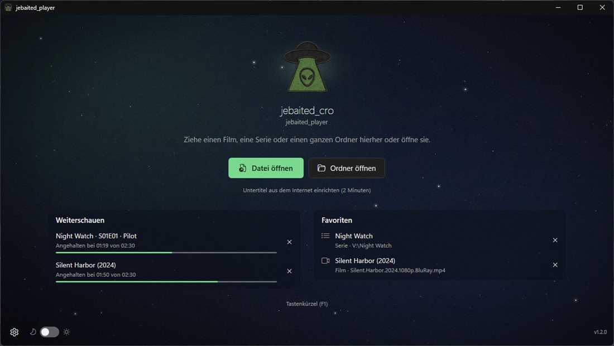
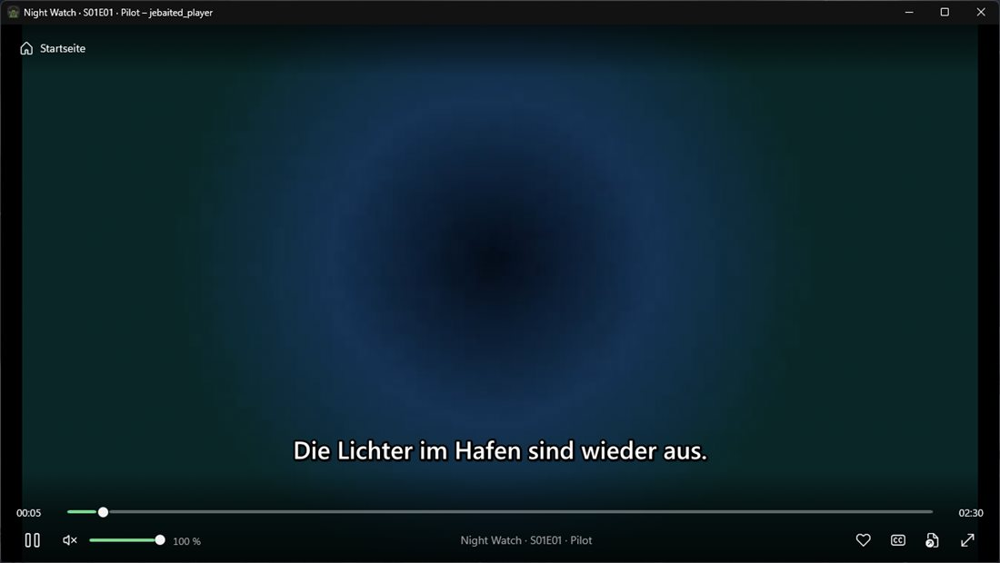
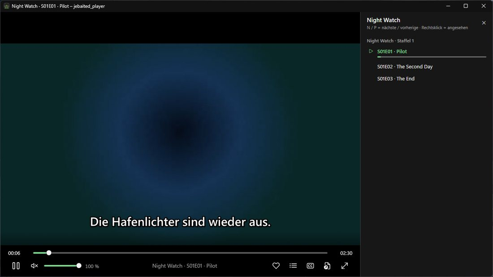
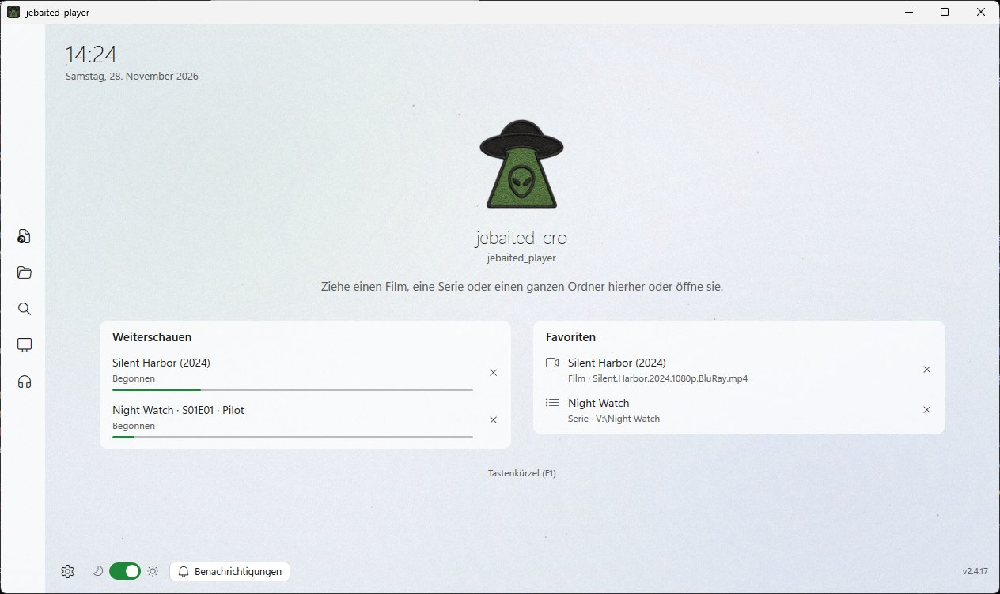
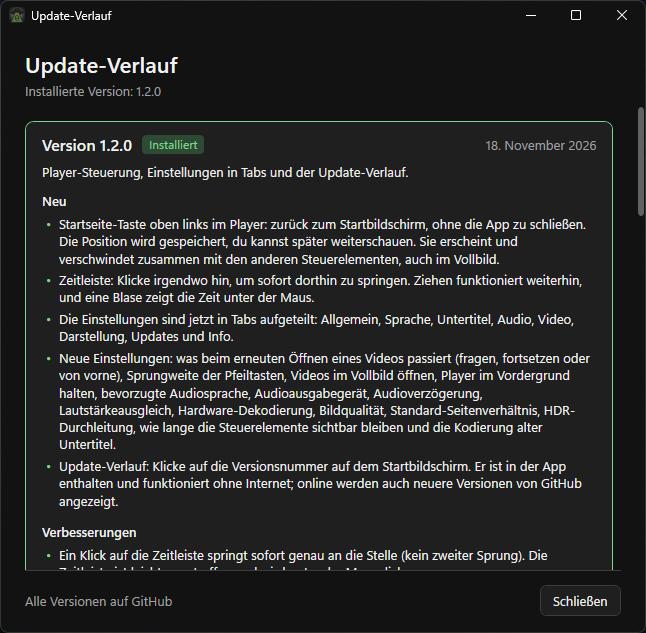
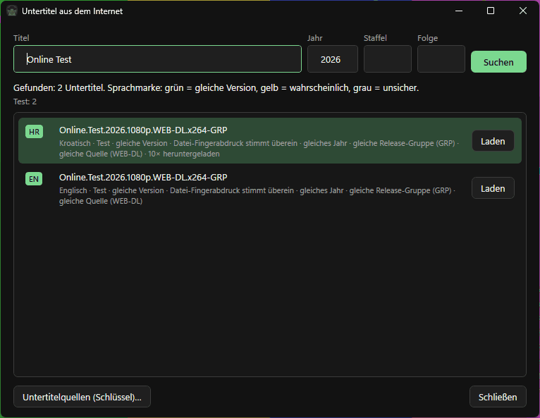

<p align="center">
  
</p>

<h1 align="center">jebaited_player — Benutzerhandbuch</h1>

<p align="center">
  <a href="README_EN.md">English</a> · <b>Deutsch</b> · <a href="README_HR.md">Hrvatski</a>
</p>

jebaited_player ist ein leichter Videoplayer für Windows. Er spielt fast jedes Video ab, sucht Untertitel selbst im Internet, prüft, ob sie zu genau deinem Video gehören, und synchronisiert sie mit der Sprache.

**Inhalt**

- [Installation](#installation)
- [A. Schnellstart](#a-schnellstart)
- [B. Grundlagen](#b-grundlagen)
- [C. Fortgeschritten](#c-fortgeschritten)

---

## Installation

1. Öffne die [neueste Version](https://github.com/jebaitedcro7/jebaited_player/releases/latest) und lade **`JebaitedPlayer-win-Setup.exe`** herunter.
2. Starte die Datei. Die Installation dauert ein paar Sekunden und braucht keine Administratorrechte. Auf dem Desktop und im Startmenü erscheint die Verknüpfung **jebaited_player**.
3. Windows zeigt eventuell das blaue Fenster „Der Computer wurde durch Windows geschützt“, weil die App noch nicht digital signiert ist. Klicke auf **Weitere Informationen → Trotzdem ausführen**. Ist **Smart App Control** eingeschaltet, kann Windows das Installationsprogramm blockieren; bitte schalte Smart App Control nicht aus, sondern warte auf eine signierte Version (siehe [CODE_SIGNING.md](CODE_SIGNING.md)).
4. Nach der Installation startet der Player und fragt nach der **Sprache**. English ist vorausgewählt, Deutsch und Hrvatski stehen daneben, die übrigen Sprachen findest du unter **Weitere Sprachen**. Wenn du nur auf **Continue** / **Weiter** klickst (oder das Fenster schließt), bleibt der Player auf Englisch. Die Sprache lässt sich jederzeit in den Einstellungen ändern.

<p align="center"></p>

Du brauchst Windows 10 oder 11 (64 Bit). Sonst muss nichts installiert werden (Download etwa 115 MB, hauptsächlich die Wiedergabe-Engine mit allen Codecs).

**Portable Version:** `JebaitedPlayer-win-Portable.zip` irgendwo entpacken und `jebaited_player.exe` starten. Sie ändert nichts in Windows (kein Eintrag unter „Öffnen mit“); Updates funktionieren auch hier.

---

## A. Schnellstart

| Was | Wie |
|---|---|
| **Film öffnen** | Doppelklick auf die Datei, Datei ins Playerfenster ziehen oder **Datei öffnen** (Ctrl+O). |
| **Ganzen Ordner öffnen** | Serienordner ins Fenster ziehen oder **Ordner öffnen** (Ctrl+Shift+O). Der Player erstellt die Folgenliste und macht dort weiter, wo du aufgehört hast. |
| **Untertitel finden** | Untertitel neben dem Video werden automatisch geladen. Untertitel aus dem Internet: einmal ein kostenloses Konto einrichten (die Anleitung öffnet sich beim ersten Start), danach sucht der Player selbst. Manuelle Suche: **Ctrl+F**. |
| **Untertitelsprache ändern** | Unten rechts auf **CC** klicken und eine Untertitelspur wählen, oder **J** für die nächste. |
| **Synchronisation anpassen** | Meist automatisch. Kommen die Untertitel zu früh oder zu spät: **G** (früher) / **H** (später) in Schritten von 0,1 s; **A** synchronisiert erneut nach der Sprache. |
| **Vollbild** | **F** oder Doppelklick auf das Bild; **Esc** zum Beenden. |

---

## B. Grundlagen

### Startbildschirm

<p align="center"></p>

- **Datei öffnen** und **Ordner öffnen** öffnen Videos; du kannst Dateien oder Ordner auch ins Fenster ziehen.
- **Weiterschauen** zeigt die letzten Videos mit der Stelle, an der du aufgehört hast. Klicken zum Fortsetzen, **×** entfernt einen Eintrag aus dem Verlauf.
- **Favoriten** enthält Filme und ganze Serien (Ctrl+D während der Wiedergabe). Eine Serie öffnet sich bei der Folge, bei der du gerade bist.
- **Tastenkürzel (F1)** zeigt alle Tastenkürzel.
- Unten links: das **Zahnrad** öffnet die Einstellungen, der **Schalter** wechselt zwischen dunklem und hellem Design. Unten rechts: die **Version** — ein Klick darauf öffnet den [Update-Verlauf](#update-verlauf).

### Wiedergabe-Steuerung

<p align="center"></p>

Die Steuerung erscheint, wenn du die Maus bewegst, und verschwindet während der Wiedergabe (die Zeit stellst du unter Einstellungen → Darstellung ein). Alles Weitere ist im Menü: **Rechtsklick** auf das Bild.

| Element | Funktion |
|---|---|
| ⌂ Startseite (oben links) | Zurück zum Startbildschirm, ohne den Player zu schließen. Die Position wird gespeichert, du kannst später weiterschauen. Erscheint und verschwindet zusammen mit der übrigen Steuerung. |
| Wiedergabe / Pause | Leertaste oder K, oder Klick auf das Bild |
| Zeitleiste | Irgendwo klicken springt sofort dorthin, oder ziehen. Eine Blase zeigt die Zeit unter der Maus. ← / → springen 5 s, Ctrl+← / → 30 s (einstellbar unter Einstellungen → Allgemein); , / . ein Bild zurück / vor |
| Lautstärke | ↑ / ↓ oder Mausrad; M schaltet den Ton aus |
| ♡ | Zu Favoriten hinzufügen / entfernen (Ctrl+D) |
| ☰ | Folgenliste (L) |
| CC | Untertitel-Menü |
| Öffnen | Datei öffnen (Ctrl+O) |
| ⤢ | Vollbild (F) |

Öffnest du ein Video, das du schon angefangen hast, fragt der Player **Weiterschauen?** (Enter = fortsetzen, Pos1 = von vorne). Unter Einstellungen → Allgemein kannst du stattdessen immer fortsetzen oder immer von vorne beginnen lassen.

### Folgenliste

<p align="center"></p>

- Beim Öffnen eines Ordners oder einer einzelnen Folge entsteht eine Liste aller Folgen, gruppiert nach Serie und Staffel. Sample-Dateien werden übersprungen.
- **N** / **P** nächste / vorherige Folge, **L** blendet die Liste ein oder aus.
- Die aktuelle Folge ist grün; ein Häkchen bedeutet angesehen (ab 95 %). Rechtsklick auf eine Folge markiert sie als angesehen oder nicht angesehen.
- Am Ende einer Folge bietet eine Karte die nächste an und startet sie nach einem Countdown (einstellbar unter Einstellungen → Allgemein → Serien, oder abschaltbar).

### Untertitel

Die Schaltfläche **CC** (oder Rechtsklick → **Untertitel**) öffnet das Untertitel-Menü:

- die Liste der Untertitel (im Video eingebettet und Dateien daneben) und **Keine Untertitel**;
- **Untertitel im Internet suchen…** (Ctrl+F) und **Untertitel aus Datei laden…** (Ctrl+T);
- **Zeichenkodierung** für Dateien mit falschen Zeichen;
- **Nach Sprache synchronisieren** (A), **Untertitel-Synchronisation…**, **Ursprüngliche Synchronisation wiederherstellen** (Ctrl+Backspace), **Untertitel ausblenden** (V);
- **Untertitel-Einstellungen…** (öffnet Einstellungen → Untertitel), **Untertitel aus dem Internet einrichten…**, **Untertitelquellen (Schlüssel)…**.

Untertitel mit demselben Namen wie das Video (`Film.srt`, `Film.de.srt`, `Film.ger.srt`…) und Untertitel in MKV-Dateien werden automatisch geladen. Welche Sprache zuerst gewählt wird, legst du unter **Einstellungen → Untertitel → Untertitelsprachen (Reihenfolge der Priorität)** fest.

<p align="center"></p>

Im selben Tab stellst du die automatische Suche, die Zeichenkodierung alter Untertitel und das Aussehen ein: Schrift, Größe, Umrandung, Höhe auf dem Bildschirm, Farbe, Fett und einen dunklen Hintergrund hinter dem Text. Änderungen sind sofort im Video sichtbar (ASS-Untertitel behalten ihre eigenen Stile).

### Audio

- **Lautstärke:** ↑ / ↓, Mausrad oder Schieberegler; **M** schaltet den Ton aus.
- **Audiospur:** **B** wechselt zur nächsten, oder Rechtsklick → **Audio** und eine Spur wählen (Sprache, Format und Kanäle werden angezeigt). Die Wahl wird pro Video gespeichert.
- **Einstellungen → Audio:** bevorzugte Audiosprache, Ausgabegerät, Audio-Synchronisierung (z. B. für Bluetooth-Kopfhörer), Lautstärkeausgleich für leise Dialoge und ein 10-Band-Equalizer mit Voreinstellungen und eigener Einstellung.

### Mini-Player

- Rechtsklick → **Mini-Player** oder **Ctrl+M**: ein kleines Fenster im Winamp-Stil, das im Vordergrund bleibt. Die Musik läuft weiter; **Ctrl+M** führt zurück zum vollen Player.
- Grüne Anzeige mit Zeit (Klick: Restzeit) und echter L/R-Pegelanzeige, laufender Interpret und Titel, Suchleiste, Zurück / Abspielen / Pause / Stopp / Weiter, Öffnen, Lautstärke. **EQ** und **PL** öffnen darunter Equalizer und Wiedergabeliste.
- Die Leisten-Taste macht daraus eine schmale Leiste; Ecke ziehen, Ctrl + Mausrad oder Ctrl + / − ändert die Größe. Position und Größe werden gespeichert.
- Ein einzelnes Lied spielt das ganze Album (alle Lieder im Ordner) nacheinander ohne Countdown.

### Sicherung und Übertragung

Einstellungen → Allgemein → **Sicherung und Übertragung**: Einstellungen und Wiedergabeverlauf werden einmal täglich und vor jedem Update automatisch kopiert (die letzten 7 bleiben auf deinem Computer). **Einstellungen exportieren** speichert sie in einer Datei (ohne Passwörter, Schlüssel für Untertitelseiten und Fensterposition), **Einstellungen importieren** lädt sie wieder, auch auf einem anderen Computer.

### Sprache der App

<p align="center"></p>

Öffne die Einstellungen (Zahnrad auf dem Startbildschirm oder Rechtsklick → **Einstellungen…**) und den Tab **Sprache**. Auf English, Deutsch oder Hrvatski klicken; Bosanski, Srpski und Slovenščina stehen unter **Weitere Sprachen**. Der ganze Player wechselt sofort, auch offene Fenster, Menüs und Meldungen. Ein Neustart ist nicht nötig, und die Sprache bleibt nach dem Schließen, einem Neustart des Computers und einem Update erhalten.

### Dunkles / helles Design

<p align="center"></p>

Mit dem Schalter unten links auf dem Startbildschirm (Mond = dunkel, Sonne = hell) oder unter **Einstellungen → Darstellung → Design**. Die Änderung gilt sofort und wird gespeichert. Dunkel ist Standard. Die Steuerung über dem Video bleibt immer dunkel, damit sie auf dem Bild gut sichtbar ist; Video und Untertitel werden vom Design nicht verändert.

### Verlauf und Favoriten

- Die Position wird alle paar Sekunden, beim Pausieren, beim Klick auf **Startseite** und beim Schließen des Players gespeichert.
- **Weiterschauen** zeigt die letzten Videos (× entfernt eines aus dem Verlauf).
- **Favoriten:** Ctrl+D fügt einen Film oder die ganze Serie der aktuellen Folge hinzu; × auf dem Startbildschirm entfernt ihn.

### Einstellungen

Die Einstellungen sind in Tabs aufgeteilt. Jede Änderung gilt sofort (auch für das laufende Video) und wird gespeichert.

| Tab | Was du einstellst |
|---|---|
| Allgemein | Fortsetzen eines begonnenen Videos (fragen / fortsetzen / von vorne), Sprungweite der Pfeiltasten, Videos im Vollbild öffnen, Player im Vordergrund halten, Serien (nächste Folge, Countdown), Screenshot-Ordner, „Öffnen mit“ und Standard-Player |
| Sprache | Sprache der App |
| Untertitel | Untertitelsprachen und ihre Reihenfolge, automatisches Laden und Suchen, Quellen im Internet, Zeichenkodierung alter Untertitel, Aussehen, Synchronisierung |
| Audio | Lautstärke, Lautstärkeausgleich, Equalizer, bevorzugte Audiosprache, Ausgabegerät, Audio-Synchronisierung |
| Video | Bildqualität, Hardware-Dekodierung, Standard-Seitenverhältnis, HDR |
| Darstellung | Dunkles / helles Design, wie lange die Steuerung sichtbar bleibt, Oberfläche über die GPU darstellen |
| Updates | Version, jetzt prüfen, automatischer Download, Neuerungen, Update-Verlauf |
| Info | Version, Lizenz, verwendete Technologien, Handbuch, Datenschutz, Richtlinie zur Code-Signierung |

### Update-Verlauf

<p align="center"></p>

Klicke unten rechts auf dem Startbildschirm auf die Versionsnummer und wähle **Update-Verlauf anzeigen**. Jede Version steht mit Datum, neuen Funktionen, Verbesserungen, Fehlerbehebungen und bekannten Problemen da. Der Verlauf ist im Player enthalten und funktioniert ohne Internet; online erscheinen neuere Versionen von GitHub oben. Derselbe Verlauf steht in [CHANGELOG_DE.md](CHANGELOG_DE.md) und auf der [Release-Seite](https://github.com/jebaitedcro7/jebaited_player/releases).

---

## C. Fortgeschritten

### Automatische Untertitelsuche

Hat ein Video keine Untertitel in der ersten Sprache deiner Liste, sucht der Player selbst im Internet. Dafür braucht er mindestens eine Quelle mit deinem kostenlosen Konto; die kurze Anleitung (Rechtsklick → Untertitel → **Untertitel aus dem Internet einrichten…**) öffnet die Registrierungsseite, prüft deine Daten und speichert sie.

| Quelle | Was du brauchst | Hinweis |
|---|---|---|
| OpenSubtitles.com (empfohlen) | Kostenloses Konto und kostenloser API-Schlüssel | Die einzige Quelle, die die genaue Version am Datei-Fingerabdruck erkennt |
| SubDL.com | Kostenloser API-Schlüssel | Zusätzliche Untertitel, wenn OpenSubtitles keine hat |
| Titlovi.com | Konto | Große kroatische Datenbank; aus, bis du sie einschaltest |

- Untertitel werden nur dann automatisch geladen, wenn sie zur **gleichen Version** gehören (Datei-Fingerabdruck) oder die Prüfung anhand der Sprache sie bestätigt. Sonst sagt dir der Player Bescheid und du wählst selbst (Ctrl+F).
- Heruntergeladene Untertitel werden neben dem Video gespeichert (z. B. `Film.de.srt`) und laden beim nächsten Mal ohne Internet.
- Ein kostenloses OpenSubtitles-Konto hat ein tägliches Download-Limit. Der Player merkt sich heruntergeladene Untertitel und lädt dieselben nie zweimal herunter.
- Passwörter und Schlüssel werden verschlüsselt gespeichert (Windows DPAPI) und nur an die Quelle gesendet, zu der sie gehören.

### Untertitel manuell herunterladen

<p align="center"></p>

**Ctrl+F** (oder CC → **Untertitel im Internet suchen…**) öffnet die Suche. Titel, Jahr, Staffel und Folge werden aus dem Dateinamen übernommen; korrigiere sie bei Bedarf und klicke auf **Suchen**. Die Sprachmarke zeigt, wie sicher die Zuordnung ist: **grün** = gleiche Version, **gelb** = wahrscheinlich, **grau** = unsicher. **Laden** lädt die Untertitel herunter, prüft sie und lädt sie.

### Synchronisation

<p align="center"></p>

Öffnen mit CC → **Untertitel-Synchronisation…**. Oben steht die aktuelle Korrektur. Korrekturen werden pro Video und Untertiteldatei gespeichert; die Originaldatei wird nie verändert.

1. **Automatisch nach Sprache (empfohlen).** Beim Laden externer Text-Untertitel vergleicht der Player sie mit der Sprache im Video und korrigiert Versatz, Geschwindigkeit (z. B. Untertitel für 25 fps bei einem 23,976-fps-Video) und Sprünge bei einem anderen Schnitt. Übernommen wird nur ein geprüftes Ergebnis. Untertitel einer anderen Folge oder eines anderen Films lösen eine Warnung aus. Erneut starten mit **A** oder **Synchronisieren (A)**. Eingebettete Untertitel sind bereits synchron und werden nicht geprüft.
2. **Versatz – alle Untertitel früher oder später.** **G** / **H** verschieben um 0,1 s (Shift: 1 s, Ctrl: 10 ms), oder die Schaltflächen nutzen, oder einen genauen Wert in Sekunden eingeben und Enter drücken. Minus = früher.
3. **Untertitel nach und nach zu spät oder zu früh.** Wenn sie an der aktuellen Stelle stimmen, weiter hinten aber abweichen: Jeder Klick ändert 0,5 s pro 10 Minuten; die gerade sichtbare Zeile bleibt, wo sie ist.
4. **Nach Zeile ausrichten (am genauesten).** Halte an, wenn eine Zeile beginnt, klicke auf **Zeilen um diese Stelle anzeigen**, wähle die Zeile und klicke auf **Diese Zeile beginnt jetzt**. Bei Bedarf weiter hinten im Video wiederholen: Aus mehreren Punkten berechnet der Player Versatz, Geschwindigkeit oder eine abschnittsweise Korrektur.
5. **Erweitert ▾ → Geschwindigkeit für andere FPS.** Fertige Korrekturen für 25 ↔ 23,976 ↔ 24 fps oder ein Geschwindigkeitsfaktor (1,0000 = keine Korrektur). Nur verwenden, wenn die Untertitel für eine andere Bildrate erstellt wurden.
6. **Klassisch:** **Z** drücken, wenn du eine Zeile hörst, und **X**, wenn ihr Untertitel erscheint (zwei weit auseinanderliegende Punkte korrigieren auch die Geschwindigkeit).

**Synchronisation zurücksetzen** (Ctrl+Backspace) stellt die Untertitel wie in der Datei wieder her. **Synchronisierte Untertitel speichern…** speichert eine korrigierte Kopie (z. B. `Film.de.sync.srt`).

### Unterstützte Formate

| Typ | Formate |
|---|---|
| Video | MP4, MKV, AVI, MOV, WMV, FLV, WebM, MPEG/MPG, M4V, TS/MTS/M2TS, VOB, 3GP, OGV — H.264, HEVC, AV1, VP9, 4K und HDR, Hardware-Dekodierung |
| Audio | MP3, AAC, FLAC, WAV, OGG, Opus, AC3, DTS, E-AC3, M4A, WMA, MKA |
| Untertiteldateien | SRT, ASS/SSA, WebVTT, MicroDVD und SubViewer (.sub), VobSub (.sub + .idx), TTML/DFXP, PGS (.sup) |
| Eingebettete Untertitel | Text (SRT, ASS, WebVTT, MP4-Text) und bildbasiert (PGS, VobSub, DVB) |
| Zeichenkodierungen | UTF-8, UTF-16, Windows-1250/1251/1252, ISO-8859-2 — automatisch erkannt, im Untertitel-Menü änderbar |

Archive von Untertitelseiten: ZIP wird unterstützt, RAR noch nicht.

### Erweiterte Wiedergabe-Einstellungen

- **Wiedergabegeschwindigkeit** 0,5–2×: **+** / **−**, **Backspace** = normal, oder Rechtsklick → **Geschwindigkeit**.
- **Seitenverhältnis:** **O** oder Rechtsklick → **Seitenverhältnis** (Original, 16:9, 4:3, 1,85:1, 2,35:1, Bild füllen).
- **Screenshot:** **S** mit Untertiteln, **Shift+S** nur Bild; gespeichert als JPG in voller Videoauflösung.
- **Zeichenkodierung:** CC → Zeichenkodierung, wenn Buchstaben wie ä, ö, ü, ß, č, ć, ž falsch aussehen.
- **Standard-Player:** Einstellungen → Allgemein → Windows → **Als Standard-Player festlegen…**; die Windows-Einstellungen öffnen sich, dort auf „Als Standard festlegen“ klicken. Windows erlaubt Programmen nicht, das selbst zu tun.
- **Ein Fenster:** Eine Datei, die du öffnest, während der Player läuft, geht an den offenen Player; mehrere ausgewählte Dateien öffnen sich als eine Liste.
- **Oberfläche über die GPU darstellen:** standardmäßig aus (zuverlässiger); gilt nach einem Neustart. Video nutzt immer die GPU.
- **Bildqualität und Dekodierung:** Einstellungen → Video — ausgewogen (Standard), hohe Qualität (schärfere Skalierung, mehr GPU-Last) oder schnell (ältere Computer); die Hardware-Dekodierung lässt sich abschalten, wenn das Bild fehlerhaft ist.

### Tastenkürzel

| Taste | Aktion |
|---|---|
| Leertaste / K | Wiedergabe / Pause |
| ← / → | 5 s zurück / vor (Ctrl: 30 s; einstellbar unter Einstellungen → Allgemein) |
| ↑ / ↓ / Mausrad | Lautstärke |
| M | Ton aus / an |
| F / Doppelklick | Vollbild (Esc zum Beenden) |
| , / . | Bild zurück / vor |
| N / P / L | Nächste / vorherige Folge / Folgenliste |
| Ctrl+O / Ctrl+Shift+O | Video öffnen / Ordner öffnen |
| Ctrl+T / Ctrl+F | Untertitel aus Datei / aus dem Internet |
| V / J | Untertitel ein- oder ausblenden / nächste Untertitel |
| G / H | Untertitel früher / später |
| Z, dann X | Nach Zeile synchronisieren |
| A | Nach Sprache synchronisieren |
| B | Nächste Audiospur |
| + / − / Backspace | Schnellere / langsamere / normale Wiedergabe |
| O | Seitenverhältnis |
| S / Shift+S | Screenshot (mit / ohne Untertitel) |
| Ctrl+D | Zu Favoriten hinzufügen / entfernen |
| Ctrl+M | Mini-Player / zurück zum vollen Player |
| Ctrl+Backspace | Ursprüngliche Untertitel-Synchronisation wiederherstellen |
| F1 | Alle Tastenkürzel |

### Updates und deine Daten

Der Player prüft 20 Sekunden nach dem Start und danach alle 12 Stunden auf GitHub, ob es eine neue Version gibt, lädt sie im Hintergrund herunter und **installiert sie beim Schließen des Players** — beim Anschauen wird nichts unterbrochen. Unter Einstellungen → Updates siehst du die Version, kannst sofort prüfen oder den automatischen Download abschalten.

Einstellungen (auch Sprache und Design), Verlauf, Schlüssel und Zwischenspeicher liegen in `%LOCALAPPDATA%\jebaited_player`, getrennt vom Programm, und bleiben bei Updates und Neuinstallationen erhalten.

### Problemlösung

- **„Der Computer wurde durch Windows geschützt“** — die App ist noch nicht signiert: Weitere Informationen → Trotzdem ausführen. Smart App Control: siehe [CODE_SIGNING.md](CODE_SIGNING.md); bitte nicht ausschalten.
- **Es werden keine Untertitel gefunden** — prüfe, ob eine Quelle eingerichtet ist (Einstellungen → Untertitel → Untertitelquellen (Schlüssel)). Ist das Tageslimit aufgebraucht, warte bis morgen oder füge SubDL hinzu. Manuell suchen kannst du immer mit **Ctrl+F** und dort Titel, Staffel und Folge korrigieren.
- **Untertitel sind falsch oder passen nicht** — meldet der Player, dass sie nicht zur Sprache passen, gehören sie wahrscheinlich zu einer anderen Folge oder Version: Ctrl+F und andere wählen. Ctrl+Backspace macht die manuelle Synchronisation rückgängig.
- **Seltsame Zeichen statt Buchstaben** — CC → Zeichenkodierung → Windows-1252, Windows-1250 oder ISO-8859-2. Passiert das bei den meisten deiner Untertitel, stelle es einmal unter Einstellungen → Untertitel → Zeichenkodierung alter Untertitel ein.
- **Weiße oder leere Fenster** — prüfe, dass Einstellungen → Darstellung → Erweitert → „Oberfläche über die GPU darstellen“ aus ist (Standard).
- **Ein Video wird nicht abgespielt** — der Grund steht im Protokoll: `%LOCALAPPDATA%\jebaited_player\logs\app.log`. Öffne ein Issue auf GitHub und hänge es an (es enthält keine Passwörter oder Schlüssel).
- **Deinstallieren** — Windows-Einstellungen → Apps → jebaited_player → Deinstallieren. Auch „Öffnen mit“ wird entfernt. Einstellungen und Verlauf bleiben in `%LOCALAPPDATA%\jebaited_player`; lösche den Ordner, wenn du sie nicht brauchst.

### Datenschutz

- Ins Internet gehen nur: Untertitelsuchen (Titel, Jahr, Staffel/Folge, Datei-Fingerabdruck) an die Quellen, die du eingerichtet hast, die Anmeldung bei diesen Quellen mit deinem Konto und die Update-Prüfung auf GitHub.
- Passwörter und Schlüssel sind verschlüsselt (Windows DPAPI, an dein Windows-Konto gebunden) und werden nie ins Protokoll geschrieben.
- Keine Statistiken, kein Tracking. Alle Details: [PRIVACY.md](PRIVACY.md).

### Übersetzungen

Die Oberfläche gibt es auf English, Deutsch, Hrvatski, Bosanski, Srpski (latinica) und Slovenščina. Jede Sprache ist eine Datei in `src/JebaitedPlayer.Localization/Languages/`; eine neue Sprache ist eine Kopie von `en.json` mit der Übersetzung. Verbesserungen sind willkommen (Issue oder Pull Request).

### Für Entwickler

```powershell
# .NET 10 SDK; libmpv-2.dll wird vom Skript heruntergeladen und geprüft (SHA256):
.\tools\get-libmpv.ps1
dotnet build jebaited_player.slnx -c Release
dotnet test jebaited_player.slnx -c Release
```

### Lizenz

[GPL-3.0](LICENSE). Komponenten anderer Autoren und ihre Lizenzen: [THIRD_PARTY_NOTICES.md](THIRD_PARTY_NOTICES.md).
