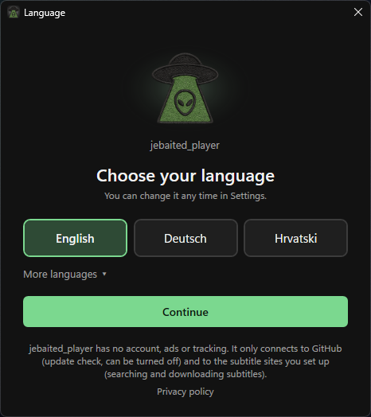
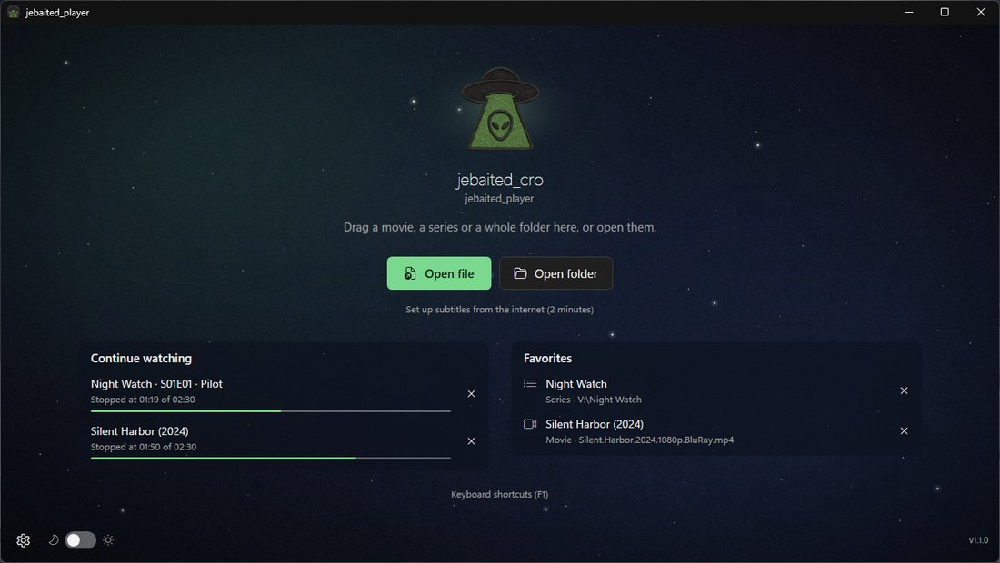
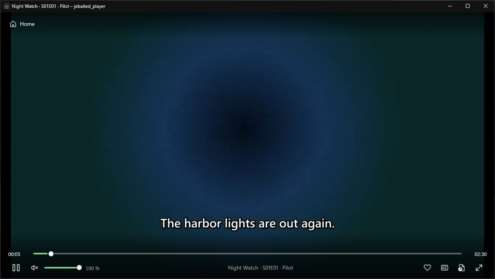
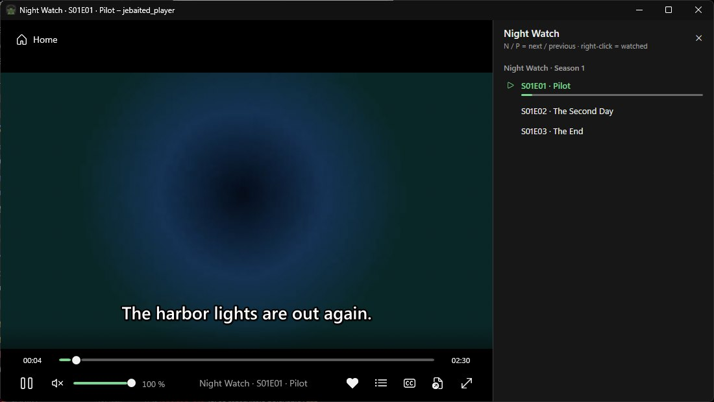
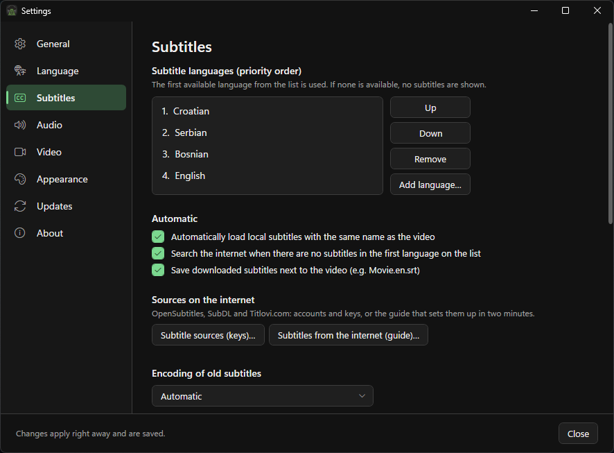
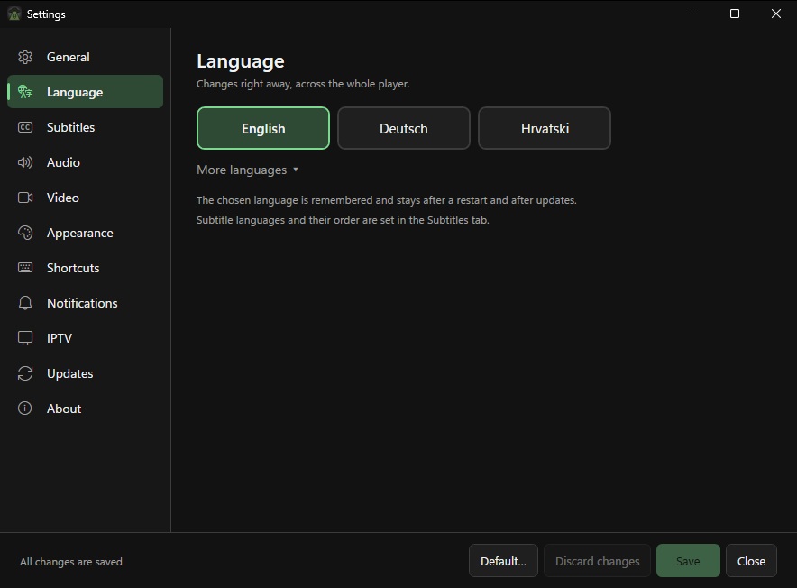
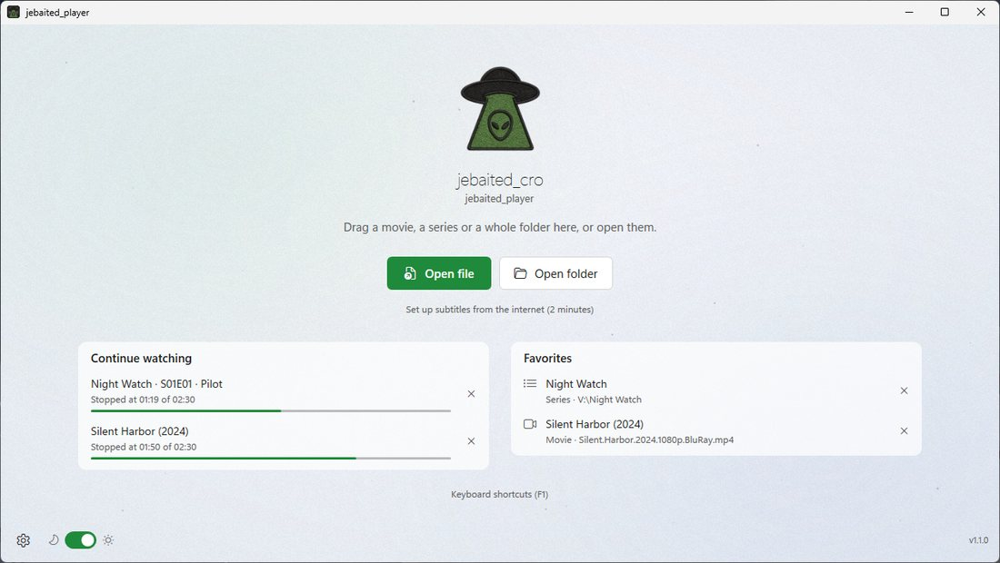
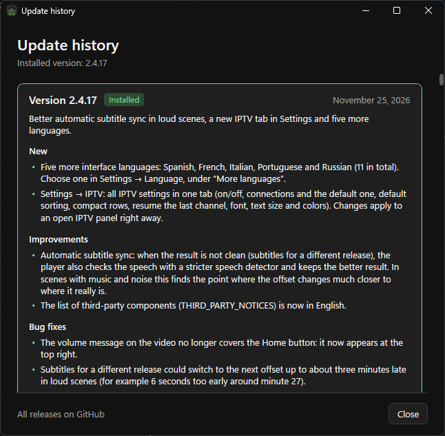
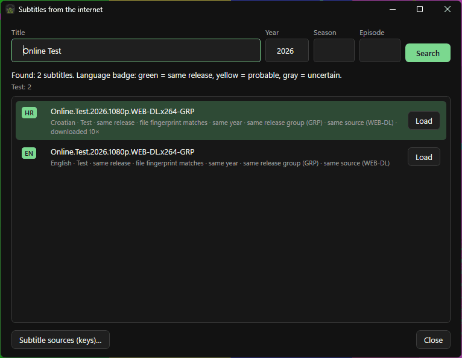
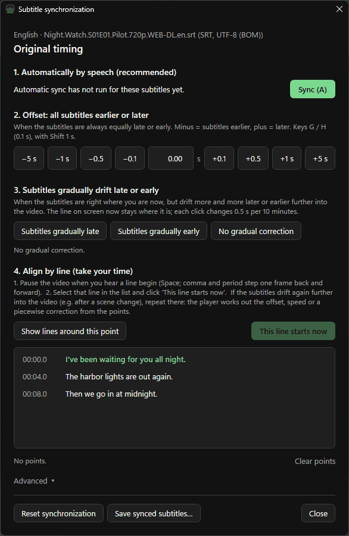

<p align="center">
  
</p>

<h1 align="center">jebaited_player — User Manual</h1>

<p align="center">
  <b>English</b> · <a href="README_DE.md">Deutsch</a> · <a href="README_HR.md">Hrvatski</a>
</p>

jebaited_player is a lightweight video player for Windows. It plays almost any video, finds subtitles on the internet by itself, checks that they belong to your exact video and syncs them to the speech.

**Contents**

- [Installation](#installation)
- [A. Quick Start](#a-quick-start)
- [B. Basic Guide](#b-basic-guide)
- [C. Advanced Guide](#c-advanced-guide)

---

## Installation

1. Open the [latest release](https://github.com/jebaitedcro7/jebaited_player/releases/latest) and download **`JebaitedPlayer-win-Setup.exe`**.
2. Run it. Installation takes a few seconds and needs no administrator rights. A **jebaited_player** shortcut appears on the desktop and in the Start menu.
3. Windows may show a blue “Windows protected your PC” window, because the app is not digitally signed yet. Click **More info → Run anyway**. If **Smart App Control** is on, Windows may block the installer; please do not turn Smart App Control off, wait for a signed release instead (see [CODE_SIGNING.md](CODE_SIGNING.md)).
4. When the installation finishes, the player starts and asks for the **language**. English is preselected; Deutsch and Hrvatski are next to it, and the other languages are under **More languages**. If you just click **Continue** (or close the window), the player stays in English. You can change the language any time in Settings.

<p align="center"></p>

You need Windows 10 or 11 (64-bit). Nothing else has to be installed (download size about 115 MB, mostly the playback engine with all codecs).

**Portable version:** unzip `JebaitedPlayer-win-Portable.zip` anywhere and run `jebaited_player.exe`. It does not change anything in Windows (no “Open with” entry); updates work in it too.

---

## A. Quick Start

| What | How |
|---|---|
| **Open a movie** | Double-click the file, drag it into the player window, or click **Open file** (Ctrl+O). |
| **Open a whole folder** | Drag a series folder into the window or click **Open folder** (Ctrl+Shift+O). The player builds the episode list and starts where you stopped. |
| **Find subtitles** | Subtitles next to the video load by themselves. Subtitles from the internet: set up a free account once (the guide opens on first start), then the player searches by itself. Manual search: **Ctrl+F**. |
| **Change the subtitle language** | Click the **CC** button at the bottom right and choose a subtitle track, or press **J** for the next one. |
| **Adjust synchronization** | Usually automatic. If subtitles are early or late: **G** (earlier) / **H** (later) in 0.1 s steps; **A** syncs to the speech again. |
| **Fullscreen** | **F** or double-click the picture; **Esc** to leave. |

---

## B. Basic Guide

### Main screen

<p align="center"></p>

- **Open file** and **Open folder** open videos; you can also drag files or folders into the window.
- **Continue watching** lists the last videos with the position where you stopped. Click to continue, **×** to remove an item from the history.
- **Favorites** holds movies and whole series (Ctrl+D while watching). A series opens at the episode you are on.
- **Keyboard shortcuts (F1)** shows all shortcuts.
- Bottom left: the **gear** opens Settings, the **switch** changes between dark and light theme. Bottom right: the **version** — click it for the [update history](#update-history).

### Playback controls

<p align="center"></p>

The controls appear when you move the mouse and hide during playback (the time can be set in Settings → Appearance). Everything else is in the menu: **right-click** the picture.

| Control | What it does |
|---|---|
| ⌂ Home (top left) | Back to the home screen without closing the player. The position is saved, so you can continue later. It shows and hides together with the other controls. |
| Play / pause | Space or K, or click the picture |
| Timeline | Click anywhere to jump there right away, or drag. A bubble shows the time under the mouse. ← / → jump 5 s, Ctrl+← / → 30 s (adjustable in Settings → General); , / . one frame back / forward |
| Volume | ↑ / ↓ or the mouse wheel; M mutes |
| ♡ | Add to / remove from favorites (Ctrl+D) |
| ☰ | Episode list (L) |
| CC | Subtitles menu |
| Open | Open file (Ctrl+O) |
| ⤢ | Fullscreen (F) |

When you open a video you have already started, the player asks **Resume watching?** (Enter = resume, Home key = from the beginning). In Settings → General you can choose to always resume or always start from the beginning instead.

### Playlist (episodes)

<p align="center"></p>

- Opening a folder or a single episode creates a list of all episodes, grouped by series and season. Sample files are skipped.
- **N** / **P** next / previous episode, **L** shows or hides the list.
- The current episode is green; a check mark means watched (95 % or more). Right-click an episode to mark it as watched or unwatched.
- At the end of an episode a card offers the next one and starts it after a countdown (adjustable in Settings → General → Series, or switch it off).

### Subtitles

The **CC** button (or right-click → **Subtitles**) opens the subtitles menu:

- the list of subtitles (embedded in the video and files next to it) and **No subtitles**;
- **Search subtitles on the internet…** (Ctrl+F) and **Load subtitles from file…** (Ctrl+T);
- **Encoding** for files with wrong characters;
- **Sync to speech** (A), **Subtitle synchronization…**, **Restore original timing** (Ctrl+Backspace), **Hide subtitles** (V);
- **Subtitle settings…** (opens Settings → Subtitles), **Set up subtitles from the internet…**, **Subtitle sources (keys)…**.

Subtitles with the same name as the video (`Movie.srt`, `Movie.en.srt`, `Movie.eng.srt`…) and subtitles inside MKV files load automatically. Which language is chosen first is set in **Settings → Subtitles → Subtitle languages (priority order)**.

<p align="center"></p>

In the same tab you set the automatic search, the encoding of old subtitles and the look: font, size, outline, position on screen, color, bold and a dark background behind the text. Changes are visible on the video right away (ASS subtitles keep their own styles).

### Audio

- **Volume:** ↑ / ↓, the mouse wheel or the slider; **M** mutes.
- **Audio track:** **B** switches to the next one, or right-click → **Audio** and choose a track (language, format and channels are shown). The choice is remembered per video.
- **Settings → Audio:** preferred audio language, output device, audio sync (for example for Bluetooth headphones), volume levelling for quiet dialogue and a 10-band equalizer with presets and your own preset.

### Mini player

- Right-click → **Mini player** or **Ctrl+M**: a small Winamp-style window that stays on top. The music keeps playing; **Ctrl+M** takes you back to the full player.
- Green display with time (click: remaining time) and a real L/R level meter, scrolling artist and title, seek bar, previous / play / pause / stop / next, open, volume. **EQ** and **PL** open the equalizer and the playlist below.
- The strip button makes it a thin bar; drag the corner, use Ctrl + mouse wheel or Ctrl + / − to make it bigger or smaller. Position and size are remembered.
- Opening one song plays the whole album (all songs in the folder), one after another without a countdown.
- Music opens the mini player, a film or series the full player (Settings → Appearance can turn this off). The mini player always opens where you left it.
- Right-click the mini player (or Settings → Appearance) for six display fonts and four VU meter styles (bars, LED segments, thin lines with peak, off).
- Films and series have their own equalizer, music and radio their own (Settings → Audio: choose which one to edit).

### Radio

- **Ctrl+R**, right-click → **Radio…** or the source label in the mini player: search stations by name, genre and country (free Radio Browser directory), press ▶ (or the name) to listen, the star keeps it in **Favorites**. Any stream URL (http/https, also .m3u/.pls) works too.
- Stations play in the mini player with the music equalizer, marked **RADIO** and **LIVE**, with the current song when the station sends it. Radio does not appear in “Continue watching”.

### Backup and transfer

Settings → General → **Backup and transfer**: settings and watch history are copied automatically once a day and before every update (the last 7 are kept on your computer). **Export settings** saves them to a file (without passwords, subtitle-site keys and the window position) and **Import settings** loads them again, also on another computer.

**Save**, **Discard changes** and **Default…** at the bottom of the settings: changes apply right away, Save keeps them, Discard changes goes back to the last save, and Default… sets the current tab or all settings back to their defaults (language, keys, volume and window positions stay).

### App language

<p align="center"></p>

Open Settings (the gear on the main screen, or right-click → **Settings…**) and the **Language** tab. Click English, Deutsch or Hrvatski; Bosanski, Srpski and Slovenščina are under **More languages**. The whole player changes right away, including open windows, menus and messages. No restart is needed, and the language is remembered after closing, restarting the computer and updating.

### Dark / Light mode

<p align="center"></p>

Use the switch at the bottom left of the main screen (moon = dark, sun = light) or **Settings → Appearance → Theme**. The change is immediate and remembered. Dark is the default. The controls over the video always stay dark so they are easy to see on the picture; the video and subtitles are not affected by the theme.

### Watch history and favorites

- The position is saved every few seconds, when you pause, when you click **Home** and when you close the player.
- **Continue watching** shows the last videos (× removes one from the history).
- **Favorites:** Ctrl+D adds a movie or the whole series of the current episode; × on the main screen removes it.

### Settings

Settings are split into tabs. Every change applies right away (also to the video that is playing) and is saved.

| Tab | What you set |
|---|---|
| General | Resuming a started video (ask / resume / from the beginning), arrow-key seek step, open videos in full screen, keep the player on top, series (next episode, countdown), screenshot folder, “Open with” and the default player |
| Language | App language |
| Subtitles | Subtitle languages and their order, automatic loading and searching, sources on the internet, encoding of old subtitles, look, synchronization |
| Audio | Volume, volume levelling, equalizer, preferred audio language, output device, audio sync |
| Video | Picture quality, hardware decoding, default aspect ratio, HDR |
| Appearance | Dark / light theme, how long the controls stay visible, rendering the interface on the GPU |
| Updates | Version, check now, automatic download, what is new, update history |
| About | Version, license, technologies used, manual, privacy, code signing policy |

### Update history

<p align="center"></p>

Click the version number at the bottom right of the main screen and choose **View update history**. Every version is listed with its date, new features, improvements, bug fixes and known issues. The history is included in the player, so it works without the internet; when you are online, newer versions from GitHub are shown at the top. The same history is in [CHANGELOG.md](CHANGELOG.md) and on the [releases page](https://github.com/jebaitedcro7/jebaited_player/releases).

---

## C. Advanced Guide

### Automatic subtitle search

When a video has no subtitles in the first language of your list, the player searches the internet by itself. It needs at least one source with your free account; the short guide (right-click → Subtitles → **Set up subtitles from the internet…**) opens the sign-up page, checks your details and saves them.

| Source | What you need | Note |
|---|---|---|
| OpenSubtitles.com (recommended) | Free account and a free API key | The only source that recognizes the exact release by the file fingerprint |
| SubDL.com | Free API key | Extra subtitles when OpenSubtitles has none |
| Titlovi.com | Account | Large Croatian database; off until you turn it on |

- Subtitles are loaded automatically only when they are for the **same release** (file fingerprint) or the check against the speech confirms them. Otherwise the player tells you and you choose yourself (Ctrl+F).
- Downloaded subtitles are saved next to the video (e.g. `Movie.en.srt`), so they load without the internet next time.
- A free OpenSubtitles account has a daily download limit. The player remembers downloaded subtitles and never downloads the same ones twice.
- Passwords and keys are stored encrypted (Windows DPAPI) and are only sent to the source they belong to.

### Manual subtitle download

<p align="center"></p>

**Ctrl+F** (or CC → **Search subtitles on the internet…**) opens the search. Title, year, season and episode are filled in from the file name; correct them if needed and click **Search**. The language badge shows how sure the match is: **green** = same release, **yellow** = probable, **gray** = uncertain. **Load** downloads, checks and loads the subtitles.

### Synchronization

<p align="center"></p>

Open it with CC → **Subtitle synchronization…**. The top line shows the current correction. Corrections are remembered per video and subtitle file; the original file is never changed.

1. **Automatically by speech (recommended).** When external text subtitles are loaded, the player compares them with the speech in the video and corrects the offset, the speed (e.g. subtitles for 25 fps on a 23.976 fps video) and jumps in a different cut. It only applies a checked result. Subtitles for a different episode or movie get a warning. Run it again with **A** or **Sync (A)**. Embedded subtitles are already in sync and are not checked.
2. **Offset — all subtitles earlier or later.** **G** / **H** move by 0.1 s (Shift: 1 s, Ctrl: 10 ms), or use the buttons, or type an exact value in seconds and press Enter. Minus = earlier.
3. **Subtitles gradually drift late or early.** When they are right where you are but drift further into the video: each click changes 0.5 s per 10 minutes; the line on screen stays where it is.
4. **Align by line (most accurate).** Pause when you hear a line begin, click **Show lines around this point**, select the line and click **This line starts now**. Repeat later in the video if needed: from several points the player calculates the offset, the speed or a piecewise correction.
5. **Advanced ▾ → Speed for a different FPS.** Ready-made corrections for 25 ↔ 23.976 ↔ 24 fps, or a speed factor (1.0000 = no correction). Use only when the subtitles were made for a different frame rate.
6. **Classic way:** press **Z** when you hear a line and **X** when its subtitle appears (two points far apart also correct the speed).

**Reset synchronization** (Ctrl+Backspace) restores the subtitles as they are in the file. **Save synced subtitles…** saves a corrected copy (e.g. `Movie.en.sync.srt`).

### Supported formats

| Type | Formats |
|---|---|
| Video | MP4, MKV, AVI, MOV, WMV, FLV, WebM, MPEG/MPG, M4V, TS/MTS/M2TS, VOB, 3GP, OGV — H.264, HEVC, AV1, VP9, 4K and HDR, hardware decoding |
| Audio | MP3, AAC, FLAC, WAV, OGG, Opus, AC3, DTS, E-AC3, M4A, WMA, MKA |
| Subtitle files | SRT, ASS/SSA, WebVTT, MicroDVD and SubViewer (.sub), VobSub (.sub + .idx), TTML/DFXP, PGS (.sup) |
| Embedded subtitles | Text (SRT, ASS, WebVTT, MP4 text) and image-based (PGS, VobSub, DVB) |
| Subtitle encodings | UTF-8, UTF-16, Windows-1250/1251/1252, ISO-8859-2 — detected automatically, can be changed in the subtitles menu |

Archives from subtitle sites: ZIP is supported; RAR is not yet.

### Advanced playback settings

- **Playback speed** 0.5–2×: **+** / **−**, **Backspace** = normal, or right-click → **Speed**.
- **Aspect ratio:** **O** or right-click → **Aspect ratio** (original, 16:9, 4:3, 1.85:1, 2.35:1, fill the screen).
- **Screenshot:** **S** with subtitles, **Shift+S** picture only; saved as JPG at the full video resolution.
- **Encoding:** CC → Encoding, if letters such as č, ć, ž, š, đ, ä, ö, ü look wrong.
- **Default player:** Settings → General → Windows → **Set as default player…**; Windows Settings opens, where you click “Set default”. Windows does not let programs do this themselves.
- **One window:** a file opened while the player is running goes to the open player; several selected files open as one list.
- **Render the interface on the GPU:** off by default (more reliable); takes effect after a restart. Video always uses the GPU.
- **Picture quality and decoding:** Settings → Video — balanced (default), high quality (sharper scaling, more GPU load) or fast (older computers); hardware decoding can be switched off if the picture is broken.

### Keyboard shortcuts

| Key | Action |
|---|---|
| Space / K | Play / pause |
| ← / → | 5 s back / forward (Ctrl: 30 s; adjustable in Settings → General) |
| ↑ / ↓ / mouse wheel | Volume |
| M | Mute / unmute |
| F / double-click | Fullscreen (Esc to exit) |
| , / . | Frame back / forward |
| N / P / L | Next / previous episode / episode list |
| Ctrl+O / Ctrl+Shift+O | Open video / open folder |
| Ctrl+T / Ctrl+F | Subtitles from file / from the internet |
| V / J | Show or hide subtitles / next subtitles |
| G / H | Subtitles earlier / later |
| Z, then X | Sync by line |
| A | Sync to speech |
| B | Next audio track |
| + / − / Backspace | Faster / slower / normal playback |
| O | Aspect ratio |
| S / Shift+S | Screenshot (with / without subtitles) |
| Ctrl+D | Add to / remove from favorites |
| Ctrl+M | Mini player / back to the full player |
| Ctrl+R | Radio |
| Ctrl+Backspace | Restore original subtitle timing |
| F1 | All shortcuts |

### Updates and your data

The player checks GitHub for a new version 20 seconds after it starts and every 12 hours, downloads it in the background and **installs it when you close the player** — nothing is interrupted while you watch. Settings → Updates shows the version and lets you check now or switch off automatic downloads.

Settings (including language and theme), watch history, keys and caches are stored in `%LOCALAPPDATA%\jebaited_player`, separately from the program, so updates and reinstalls keep them.

### Troubleshooting

- **“Windows protected your PC”** — the app is not signed yet: More info → Run anyway. Smart App Control: see [CODE_SIGNING.md](CODE_SIGNING.md); please do not turn it off.
- **No subtitles are found** — check that a source is set up (Settings → Subtitles → Subtitle sources (keys)). If the daily limit is used up, wait until tomorrow or add SubDL. You can always search manually with **Ctrl+F** and correct the title, season and episode there.
- **Subtitles are wrong or do not match** — if the player says they do not match the speech, they are probably for a different episode or release: Ctrl+F and choose others. Ctrl+Backspace undoes manual sync.
- **Strange characters instead of letters** — CC → Encoding → Windows-1250, ISO-8859-2 or Windows-1252. If it happens with most of your subtitles, set it once in Settings → Subtitles → Encoding of old subtitles.
- **White or empty windows** — make sure Settings → Appearance → Advanced → “Render the interface on the GPU” is off (default).
- **A video does not play** — the reason is in the log: `%LOCALAPPDATA%\jebaited_player\logs\app.log`. Open an issue on GitHub and attach it (it contains no passwords or keys).
- **Uninstall** — Windows Settings → Apps → jebaited_player → Uninstall. “Open with” is removed too. Settings and history stay in `%LOCALAPPDATA%\jebaited_player`; delete that folder if you do not need them.

### Privacy

- Only these go to the internet: subtitle searches (title, year, season/episode, file fingerprint) to the sources you set up, signing in to those sources with your account, and the update check on GitHub.
- Passwords and keys are encrypted (Windows DPAPI, tied to your Windows account) and never written to the log.
- No statistics, no tracking. Full details: [PRIVACY.md](PRIVACY.md).

### Translations

The interface is available in English, Deutsch, Hrvatski, Bosanski, Srpski (latinica) and Slovenščina. Each language is one file in `src/JebaitedPlayer.Localization/Languages/`; a new language is a copy of `en.json` with the translation. Corrections are welcome (open an issue or a pull request).

### For developers

```powershell
# .NET 10 SDK; libmpv-2.dll is downloaded and verified (SHA256) by the script:
.\tools\get-libmpv.ps1
dotnet build jebaited_player.slnx -c Release
dotnet test jebaited_player.slnx -c Release
```

### License

[GPL-3.0](LICENSE). Third-party components and their licenses: [THIRD_PARTY_NOTICES.md](THIRD_PARTY_NOTICES.md).
