<p align="center">
  
</p>

<h1 align="center">jebaited_player — Korisnički priručnik</h1>

<p align="center">
  <a href="README_EN.md">English</a> · <a href="README_DE.md">Deutsch</a> · <b>Hrvatski</b>
</p>

jebaited_player je lagani video player za Windows. Reproducira gotovo svaki video, sam pronađe titlove na internetu, provjeri pripadaju li baš tvom videu i uskladi ih s govorom.

**Sadržaj**

- [Instalacija](#instalacija)
- [A. Brzi početak](#a-brzi-početak)
- [B. Osnovne upute](#b-osnovne-upute)
- [C. Napredne upute](#c-napredne-upute)

---

## Instalacija

1. Otvori [najnovije izdanje](https://github.com/jebaitedcro7/jebaited_player/releases/latest) i preuzmi **`JebaitedPlayer-win-Setup.exe`**.
2. Pokreni ga. Instalacija traje nekoliko sekundi i ne traži administratora. Na radnoj površini i u izborniku Start pojavi se prečac **jebaited_player**.
3. Windows može prikazati plavi prozor „Windows je zaštitio vaše računalo” jer program još nije digitalno potpisan. Klikni **Više informacija → Ipak pokreni**. Ako je uključen **Smart App Control**, Windows blokira instalaciju i sam program (provjerava svaki program i biblioteku pri pokretanju). Za GitHub inačicu isključi ga: Sigurnost sustava Windows → Upravljanje aplikacijama i preglednikom → Postavke za Smart App Control → Isključeno. Ako ga poslije ponovno uključiš, Windows će opet blokirati jebaited_player, a na Windows 11 inačicama koje nisu potpuno ažurirane može se ponovno uključiti samo resetiranjem Windowsa. Dok je Smart App Control uključen, koristi Microsoft Store inačicu niže (potpisuje je Microsoft). Vidi [CODE_SIGNING.md](CODE_SIGNING.md).
4. Kad instalacija završi, player se pokrene i pita za **jezik**. English je unaprijed označen, uz njega su Deutsch i Hrvatski, a ostali jezici su pod **More languages** / **Više jezika**. Ako samo klikneš **Continue** / **Nastavi** (ili zatvoriš prozor), player ostaje na engleskom. Jezik možeš promijeniti kad god želiš u Postavkama.

<p align="center">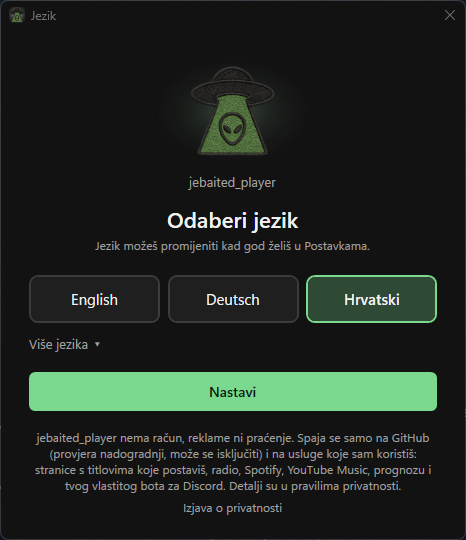</p>

Treba ti Windows 10 ili 11 (64-bitni). Ništa drugo nije potrebno instalirati (oko 115 MB preuzimanja, najviše zbog engine-a za reprodukciju sa svim kodecima).

**Prijenosna verzija:** `JebaitedPlayer-win-Portable.zip` raspakiraj bilo gdje i pokreni `jebaited_player.exe`. Ne mijenja ništa u Windowsu (nema „Otvori pomoću”), a nadogradnje rade i u njoj.

**Microsoft Store:** jebaited_player je i u [Microsoft Storeu](https://apps.microsoft.com/detail/9NP4GF0Q40JL). Store inačica radi uz Smart App Control, nadograđuje se kroz Store i može biti verziju-dvije iza GitHuba.

---

## A. Brzi početak

| Što | Kako |
|---|---|
| **Otvori film** | Dvoklik na datoteku, povuci je u prozor playera ili klikni **Otvori datoteku** (Ctrl+O). |
| **Otvori cijelu mapu** | Povuci mapu serije u prozor ili klikni **Otvori mapu** (Ctrl+Shift+O). Player složi popis epizoda i krene od mjesta gdje si stao. |
| **Pronađi titlove** | Titlovi uz video učitaju se sami. Titlovi s interneta: jednom postavi besplatan račun (vodič se otvori pri prvom pokretanju), a dalje player traži sam. Ručna pretraga: **Ctrl+F**. |
| **Promijeni jezik titlova** | Klikni gumb **CC** dolje desno i odaberi titlove, ili **J** za sljedeće. |
| **Podesi sinkronizaciju** | Uglavnom radi sama. Ako titlovi žure ili kasne: **G** (ranije) / **H** (kasnije) po 0,1 s; **A** ponovno sinkronizira prema govoru. |
| **Cijeli zaslon** | **F** ili dvoklik na sliku; **Esc** za izlaz. |

---

## B. Osnovne upute

### Glavni ekran

<p align="center">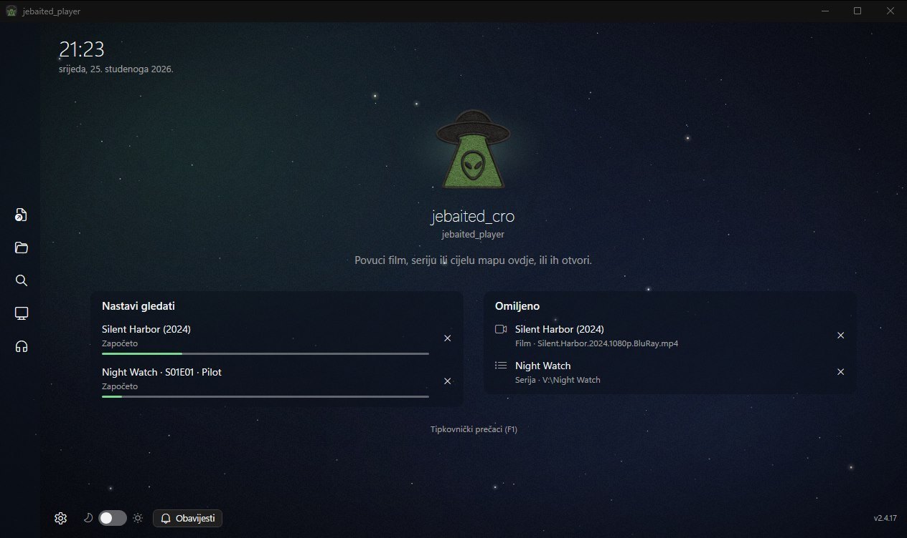</p>

- **Bočna traka** lijevo (ikone; pod mišem se proširi i pokaže nazive): **Otvori datoteku**, **Otvori mapu**, **Pretraga titlova**, **IPTV** i **Radio**. Datoteke i mape možeš i povući u prozor.
- **Nastavi gledati** prikazuje zadnje videe s mjestom gdje si stao. Klik nastavlja, **×** uklanja stavku iz povijesti.
- **Omiljeno** sadrži filmove i cijele serije (Ctrl+D tijekom gledanja). Serija se otvara na epizodi na kojoj si.
- **Tipkovnički prečaci (F1)** prikazuje sve prečace.
- Dolje lijevo: **zupčanik** otvara Postavke, **prekidač** mijenja tamnu i svijetlu temu. Dolje desno: **verzija** — klik na nju otvara [povijest nadogradnji](#povijest-nadogradnji).

### Kontrole reprodukcije

<p align="center">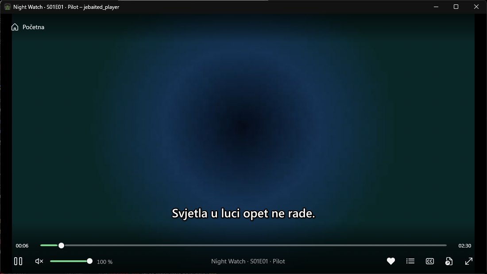</p>

Kontrole se pojave kad pomakneš miš i sakriju se tijekom gledanja (vrijeme se podešava u Postavke → Izgled). Sve ostalo je u izborniku: **desni klik** na sliku.

| Kontrola | Što radi |
|---|---|
| ⌂ Početna (gore lijevo) | Povratak na početni ekran bez zatvaranja playera. Glazba i radio sviraju dalje, a početni ekran prikazuje traku reprodukcije (pjesma, izvor, Play/Pause, Prethodna/Sljedeća, glasnoća); video se zatvara i pozicija se sprema, pa možeš nastaviti kasnije. Pojavljuje se i skriva zajedno s ostalim kontrolama. |
| Reproduciraj / pauziraj | Razmaknica ili K, ili klik na sliku |
| Vremenska traka | Klik bilo gdje odmah skoči na to mjesto, ili povuci. Oblačić pokazuje vrijeme ispod miša. ← / → skok 5 s, Ctrl+← / → 30 s (podešava se u Postavke → Općenito); , / . kadar natrag / naprijed |
| Glasnoća | ↑ / ↓ ili kotačić miša; M isključuje zvuk |
| ♡ | Dodaj u omiljene / ukloni (Ctrl+D) |
| ☰ | Popis epizoda (L) |
| CC | Izbornik titlova |
| Otvori | Otvori datoteku (Ctrl+O) |
| ⤢ | Cijeli zaslon (F) |

Kad otvoriš video koji si već počeo gledati, player pita **Nastaviti gledanje?** (Enter = nastavi, tipka Home = od početka). U Postavke → Općenito možeš umjesto toga odabrati da uvijek nastavi ili uvijek krene od početka.

### Popis epizoda

<p align="center">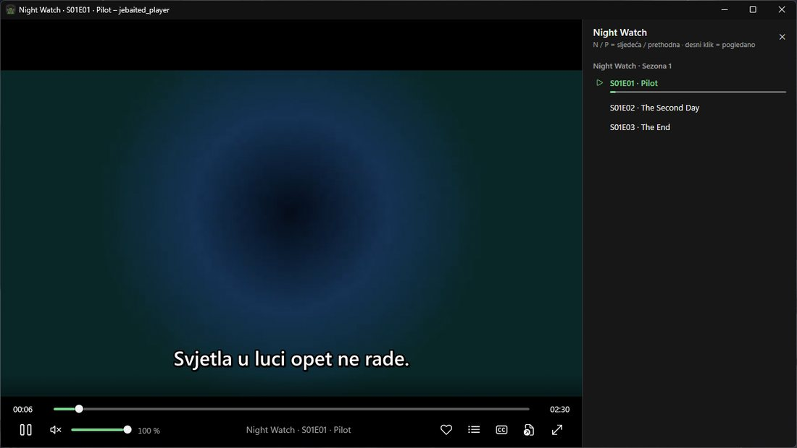</p>

- Otvaranjem mape ili jedne epizode nastaje popis svih epizoda, grupiran po seriji i sezoni. „Sample” datoteke se preskaču.
- **N** / **P** sljedeća / prethodna epizoda, **L** prikazuje ili sakriva popis.
- Trenutna epizoda je zelena; kvačica znači pogledano (95 % ili više). Desni klik na epizodu označava je kao pogledanu ili nepogledanu.
- Na kraju epizode kartica ponudi sljedeću i pokrene je nakon odbrojavanja (podešava se u Postavke → Općenito → Serije, ili se isključuje).

### Titlovi

Gumb **CC** (ili desni klik → **Titlovi**) otvara izbornik titlova:

- popis titlova (ugrađeni u video i datoteke uz njega) i **Bez titlova**;
- **Traži titlove na internetu…** (Ctrl+F) i **Učitaj titlove iz datoteke…** (Ctrl+T);
- **Encoding** za datoteke s krivim znakovima;
- **Sinkroniziraj prema govoru** (A), **Sinkronizacija titlova…**, **Vrati originalnu sinkronizaciju** (Ctrl+Backspace), **Sakrij titlove** (V);
- **Postavke titlova…** (otvara Postavke → Titlovi), **Postavi titlove s interneta…**, **Izvori titlova (ključevi)…**.

Titlovi istog naziva kao video (`Film.srt`, `Film.hr.srt`, `Film.hrv.srt`…) i titlovi unutar MKV-a učitaju se sami. Koji se jezik bira prvi, određuješ u **Postavke → Titlovi → Jezici titlova (redoslijed prioriteta)**.

<p align="center">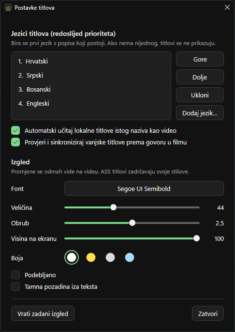</p>

U istoj kartici podešavaš automatsko traženje, kodiranje starih titlova i izgled: font, veličinu, obrub, visinu na ekranu, boju, podebljano i tamnu pozadinu iza teksta. Promjene se odmah vide na videu (ASS titlovi zadržavaju svoje stilove).

### Zvuk

- **Glasnoća:** ↑ / ↓, kotačić miša ili klizač; **M** isključuje zvuk.
- **Audio traka:** **B** prebacuje na sljedeću, ili desni klik → **Audio** i odaberi traku (prikazani su jezik, format i kanali). Izbor se pamti po videu.
- **Postavke → Zvuk:** željeni jezik zvuka, izlazni uređaj (i zaseban **izlaz za glazbu i radio**, npr. virtualni kabel za Discord), sinkronizacija zvuka (npr. za Bluetooth slušalice), ujednačavanje glasnoće za tihi dijalog i equalizer s 10 pojaseva, presetima i vlastitim presetom.

### Mini player

- Desni klik → **Mini player** ili **Ctrl+M**: mali prozor u Winamp stilu, uvijek iznad ostalih. Glazba svira dalje; **Ctrl+M** vraća na puni player.
- Zeleni zaslon s vremenom (klik: preostalo vrijeme) i stvarnim mjeračem razine L/D, pomični izvođač i naslov, traka za premotavanje, prethodna / pokreni / pauza / zaustavi / sljedeća, otvori, glasnoća. **EQ** i **PL** ispod otvaraju equalizer i popis pjesama.
- Gumb za traku pretvara ga u usku traku; povlačenje kuta, Ctrl + kotačić miša ili Ctrl + / − mijenja veličinu. Položaj i veličina se pamte.
- Otvaranje jedne pjesme pušta cijeli album (sve pjesme iz mape) jednu za drugom, bez odbrojavanja.
- Glazba otvara mini player, a film ili serija puni player (može se isključiti u Postavke → Izgled). Mini player se uvijek otvara gdje si ga ostavio.
- Desni klik na mini player (ili Postavke → Izgled): šest fontova zaslona i četiri izgleda VU metra (trake, LED segmenti, tanke linije s vrhom, isključen).
- Filmovi i serije imaju svoj equalizer, a glazba i radio svoj (Postavke → Zvuk: biraš koji uređuješ).
- **Pet izgleda** (desni klik → **Izgled** ili **Postavke → Izgled → Mini player**, gdje svaki izgled ima pregled, a promjena se primjenjuje odmah): klasični Winamp, kartica, uska traka, bočna ploča i NLO zaslon. Svi imaju iste tipke i funkcije, a tvoj odabir se pamti. Izgledi kartica i bočna ploča (i početni ekran) prikazuju **omot albuma** pjesme (ugrađen u datoteku ili slika cover/folder uz nju); bez omota prikazuju NLO logo.
- **Kotačić miša** mijenja glasnoću za 5 % po zarezu bilo gdje na playeru (video, kontrole, početni ekran i cijeli mini player), od 0 do 100 %. Popisi koji se mogu listati (popis pjesama, radio postaje …) i dalje se listaju, a **Ctrl + kotačić** mijenja veličinu mini playera.
- Naslov se neprekidno vrti u krug, a zadano prikazuje samo **izvođača i pjesmu**. Desni klik na naslov: dodaj album, godinu, žanr, kvalitetu zvuka ili naziv datoteke.
- Crvena, blago pulsirajuća oznaka **UŽIVO** prikazuje se dok svira radio (svi izgledi, puni player i početni ekran).
- **Minimiziraj** (tipka ili desni klik → Minimiziraj na taskbar) stavlja player na taskbar, a glazba svira dalje; to je nešto drugo od **Mini playera** i zatvaranja. Mini player i svi ostali prozori (Equalizer, Radio, Discord …) uvijek ostaju potpuno unutar vidljivog zaslona, iznad taskbara, i s više monitora.
- Pri pokretanju se otvara samo jedan prozor: mini player ako je to bio tvoj zadnji prikaz (ili kad otvoriš glazbu), inače puni player. Ako pokretanje ikad završi bez vidljivog prozora, player sam vraća glavni prozor, a sljedeće pokretanje ga otvara normalno, na sredini zaslona.

### Radio

- **Ctrl+R**, desni klik → **Radio…** ili oznaka izvora u mini playeru: traži postaje po nazivu, žanru i državi (besplatni imenik Radio Browser), ▶ (ili klik na naziv) je pušta, a zvjezdica je sprema u **Favorite**. Radi i bilo koji URL streama (http/https, i .m3u/.pls).
- Postaje sviraju u mini playeru s glazbenim equalizerom, označene s **RADIO** i **UŽIVO**, uz trenutnu pjesmu kad je postaja šalje. Radio ne ulazi u „Nastavi gledati”.
- **Stop** stvarno zaustavlja postaju (ostaje prikazana u mini playeru); **Play** ili razmak je ponovno spajaju, uživo. I Pauza → Play nastavlja uživo, a radio uživo se ne premotava.

### IPTV

- Klikni **IPTV** u bočnoj traci početnog ekrana (ili desni klik na videu → **IPTV…**). Panel se otvara lijevo od videa. **Dodaj vezu**: **Xtream Codes** račun (poslužitelj, korisničko ime, lozinka), **M3U/M3U8** poveznica ili M3U datoteka; **Testiraj vezu** provjerava je jednom (bez ponavljanja prijava). Možeš dodati više veza te ih bilo kad urediti, osvježiti ili ukloniti.
- Kategorije (sa zastavama i ikonama) | kanali s logotipom, programom koji je sada i trakom napretka, **★** za favorite; **pretraga**, **sortiranje** (A–Ž, Ž–A, izvorno, tvoj redoslijed: desni klik na kanal → gore/dolje), **Nedavno gledano**, skrivanje kanala ili cijele kategorije (desni klik; ⋯ → *Prikaži skrivene kanale* ih vraća). Dvoklik ili Enter pušta kanal u glavnom playeru; **F** ili dvoklik na sliku je cijeli zaslon; klik na sliku ne pauzira TV uživo (koristi gumb za pauzu). **Stop** na playeru početnog ekrana zaustavlja TV i zatvara panel.
- Vodič programa prikazuje *sada* i *sljedeće*, vremensku crtu po danima (XMLTV ili vodič same usluge) i javlja kad nema podataka.
- ⋯ → **Izgled**: font, veličina teksta, boja isticanja i pozadina samo za IPTV panel. Povuci desni rub panela i razdjelnik između kategorija i kanala na željenu širinu; pamti se. ⋯ → izvoz/uvoz postavki (favoriti, redoslijed, skriveno – nikad lozinke).
- Lozinka se sprema **šifrirana** (DPAPI) i nikad se ne prikazuje, ne zapisuje ni ne izvozi. Ako poslužitelj nudi samo običan **HTTP**, prijava i tok nisu šifrirani, a player na to upozorava. Player **ne donosi kanale ni popise**: koristi samo usluge koje smiješ koristiti. Modul isključuješ u **Postavke → IPTV**, gdje su sve postavke IPTV-a u jednoj kartici: tvoje veze i zadana veza, zadano sortiranje, zbijeni redovi, nastavak zadnjeg kanala te font, veličina teksta i boje. Promjene vrijede i za otvoreni IPTV panel.

<p align="center">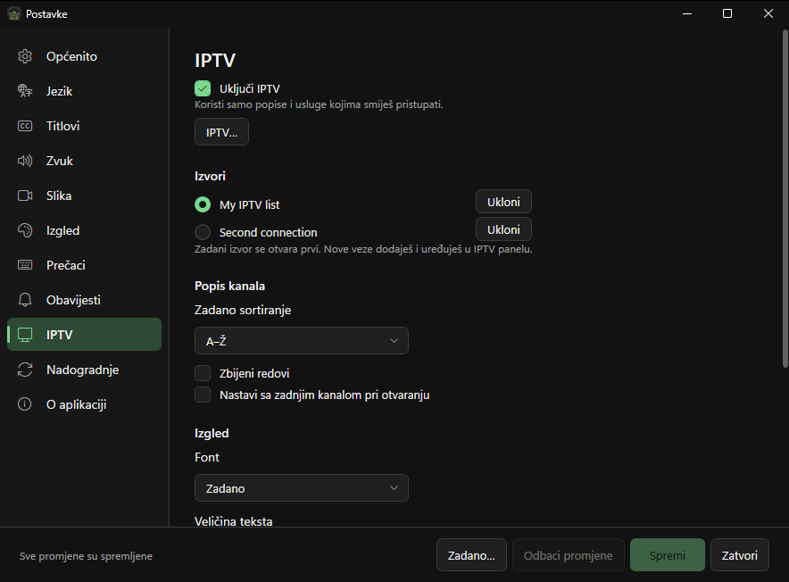</p>

### Spotify

- **Ctrl+Shift+S**, desni klik → **Spotify…** ili oznaka izvora u mini playeru. jebaited_player je daljinski za tvoju Spotify aplikaciju: glazba svira u Spotifyju (računalo, mobitel ili zvučnik), a player prikazuje pjesmu s omotom i upravlja njome. Za upravljanje treba **Spotify Premium**.
- Spotify dopušta najviše 5 korisnika po developer aplikaciji, pa se spajaš **svojom besplatnom aplikacijom**: prozor pokazuje korake (napravi aplikaciju na developer.spotify.com, dodaj prikazani redirect URI, zalijepi Client ID), zatim **Prijava u Spotify** u pregledniku.
- Play, pauza, sljedeća, premotavanje i glasnoća, tvoje **playliste**, **spremljene pjesme**, **pretraga** i **izbor uređaja**. Dok je Spotify izvor, mini player pokazuje **SPOTIFY** i njegove tipke upravljaju Spotifyjem; otvaranje datoteke ili postaje vraća natrag.
- Spotify zvuk nikad ne prolazi kroz player (bez equalizera) i nikamo se ne prosljeđuje.

### YouTube Music

- **Ctrl+Shift+Y**, desni klik → **YouTube Music…** ili oznaka izvora u mini playeru. Zalijepi link s YouTubea ili YouTube Musica (pjesma ili playlista) i stisni **Pusti link**; to radi bez računa i bez ključa.
- **Pretraga** traži tvoj besplatni YouTube API ključ: prozor pokazuje korake (Google Cloud konzola → projekt → uključi „YouTube Data API v3” → napravi API ključ). Google dopušta otprilike 100 pretraga dnevno po ključu. **API ključ…** pokraj pretrage mijenja ili uklanja ključ.
- Službeni YouTube player svira u prozoru i mora ostati vidljiv (pravila YouTubea): bez reprodukcije u pozadini i bez blokiranja reklama; smanjivanje prozora ga pauzira. Dok je YouTube izvor, mini player pokazuje **YOUTUBE** i njegove tipke upravljaju YouTubeom; otvaranje datoteke ili postaje vraća natrag.
- YouTube zvuk ne ide kroz equalizer playera.

### Bot za Discord

- **Ctrl+Shift+D**, desni klik → **Bot za Discord…** ili gumb sa slušalicama u mini playeru. Tvoj vlastiti bot ulazi u glasovni kanal na tvom Discord serveru i pušta ono što svira player: **samo lokalnu glazbu i radio**. Filmovi, YouTube Music i Spotify se nikad ne šalju (dok svira film ili je otvoren YouTube, bot šalje tišinu).
- Bota napraviš jednom, besplatno; prozor pokazuje korake: Discord Developer Portal → nova aplikacija → Install Link na None i isključen Public Bot → URL Generator s dozvolama View Channels, Connect i Speak → pozovi bota na svoj server → Reset Token. Token zalijepiš u prozor; sprema se kriptirano samo na tvom računalu.
- **Uđi u moj kanal** odvede bota u kanal u kojem si ti, a može i bilo koji kanal s popisa. Gumb sa slušalicama u mini playeru je zelen dok bot šalje glazbu. Ako botu u kanalu nedostaje dozvola, prozor napiše koja i gdje je uključiti.
- Discord čuje ono što player svira. Zadano glasnoća playera vrijedi i za Discord; u prozoru Discord možeš Discordu dati **vlastitu glasnoću**, pa kad sebi utišaš player, u kanalu nije tiše. Utišan player (ili glasnoća 0) uvijek šalje tišinu. Zvuk je end-to-end kriptiran (Discord DAVE). Bot radi samo na serverima na koje ga pozoveš, ne u privatnim pozivima. Treba Windows 11 ili Windows 10 build 20348 ili noviji.

### Torlink (pretraži online, samo GitHub inačica)

- Neobavezno i **zadano isključeno**. Uključuje se u **Postavke → Torlink**. Nakon što prihvatiš upozorenje, player s izdanja ovog repozitorija preuzima provjereni paket (Node.js + Torlink, oko 40 MB, provjera SHA-256). **Nije dio Microsoft Store inačice.**
- Zatim se u bočnoj traci početnog ekrana pojavljuje još jedna stavka, **Pretraži online filmove i serije**. Otvara Torlink stranicu: jedna pretraga kroz više javnih indeksa (filmovi, serije, anime, igre), rezultati s veličinom, seederima i izvorom (sortiranje i filter) te upravitelj preuzimanja (aktivna, red, završena, neuspjela; pauza, nastavak, otkaži, otvori mapu, reproduciraj). **Home** (ili Esc / Alt+←) vraća na početni ekran playera, a preuzimanja se nastavljaju; **Ctrl+Shift+T** otvara i zatvara stranicu.
- Torlink je projekt otvorenog koda [baairon/torlink](https://github.com/baairon/torlink) (MIT), korišten nepromijenjen. Player s njim razgovara preko njegovog lokalnog sučelja i pokreće ga samo dok treba. Postavke: mapa za preuzimanja, istodobna preuzimanja, playlist.m3u, dodatni trackeri, mrežno sučelje (VPN) i dijeljenje nakon preuzimanja (**zadano isključeno**). Ažuriranje samo na tvoj klik, iz našeg provjerenog paketa, uz automatski povratak.
- **Tvoja odgovornost:** BitTorrent drugim korisnicima otkriva tvoju IP adresu. Preuzimaj i dijeli samo ono što smiješ. Player ne pohranjuje niti provjerava nikakav sadržaj. Vidi [PRIVACY.md](PRIVACY.md).

### Kopije i prijenos

Postavke → Općenito → **Kopije i prijenos**: postavke i povijest gledanja automatski se kopiraju jednom dnevno i prije svake nadogradnje (zadnjih 7 ostaje na tvom računalu). **Izvezi postavke** sprema ih u datoteku (bez lozinki, ključeva za stranice s titlovima i položaja prozora), a **Uvezi postavke** ih ponovno učitava, i na drugom računalu.

**Spremi**, **Odbaci promjene** i **Zadano…** na dnu postavki: promjene vrijede odmah, Spremi ih zadržava, Odbaci promjene vraća zadnje spremanje, a Zadano… vraća trenutnu karticu ili sve postavke na zadano (jezik, ključevi, glasnoća i položaji prozora ostaju).

### Jezik aplikacije

<p align="center">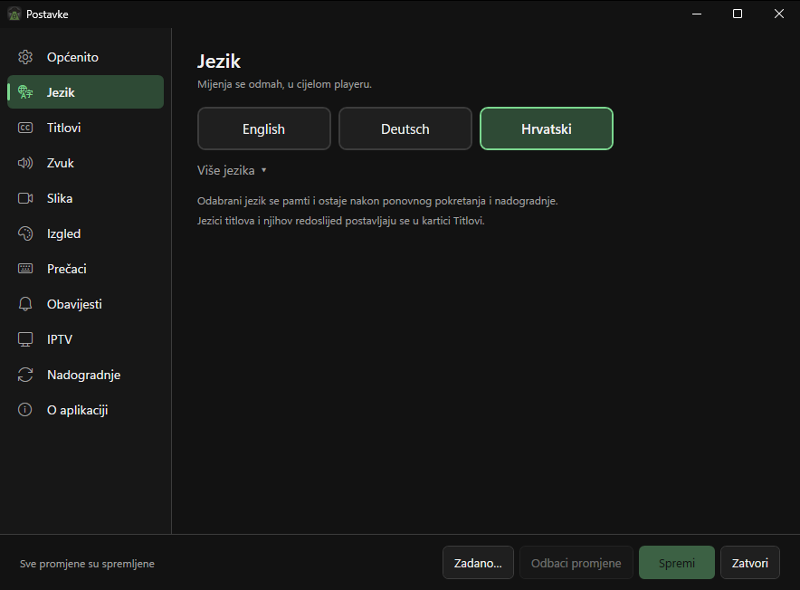</p>

Otvori Postavke (zupčanik na glavnom ekranu ili desni klik → **Postavke…**) i karticu **Jezik**. Klikni English, Deutsch ili Hrvatski; Bosanski, Srpski, Slovenščina, Español, Français, Italiano, Português i Русский su pod **Više jezika**. Cijeli player se mijenja odmah, uključujući otvorene prozore, izbornike i poruke. Ponovno pokretanje ne treba, a jezik ostaje zapamćen nakon zatvaranja, ponovnog pokretanja računala i nadogradnje.

### Tamna / svijetla tema

<p align="center">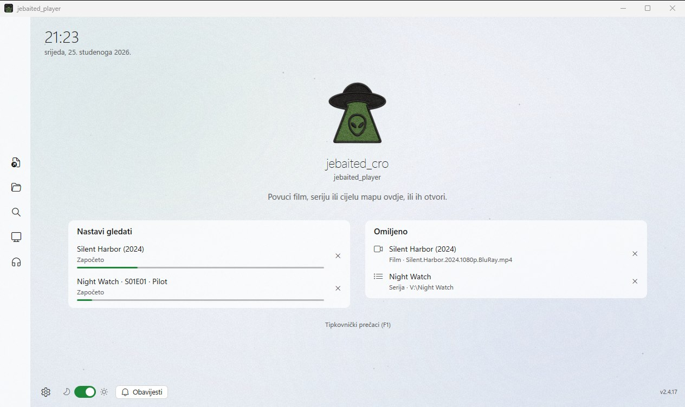</p>

Prekidačem dolje lijevo na glavnom ekranu (mjesec = tamna, sunce = svijetla) ili u **Postavke → Izgled → Tema**. Promjena je trenutna i pamti se. Tamna je zadana. Kontrole preko videa uvijek ostaju tamne, da se dobro vide na slici; tema ne mijenja video ni titlove.

### Boja isticanja

U **Postavke → Izgled → Boja isticanja** biraš boju gumba, klizača, označenih stavki i mini playera: osam gotovih boja (zelena je zadana) ili **Vlastita boja…** (nijansa, zasićenost i svjetlina ili upis #RRGGBB, uz pregled uživo; Odustani vraća prijašnju boju). Pozadina ostaje tamna ili svijetla tema, a u svakoj temi boja se po potrebi malo posvijetli ili potamni da tekst ostane čitljiv. Promjena se vidi odmah; **Spremi**, **Odbaci promjene** i **Zadano** rade kao i za ostale postavke.

### Povijest gledanja i omiljeno

- Mjesto u videu sprema se svakih nekoliko sekundi, pri pauzi, klikom na **Početna** i kad zatvoriš player.
- **Nastavi gledati** prikazuje zadnje videe (× uklanja jedan iz povijesti).
- **Omiljeno:** Ctrl+D dodaje film ili cijelu seriju trenutne epizode; × na glavnom ekranu ga uklanja.
- **Sljedeće za gledanje:** sljedeća epizoda serije koju gledaš pojavi se sama (i preko granice sezone); desni klik na video ili stavku „Nastavi gledati” → **Dodaj u Sljedeće za gledanje**; ▲ ▼ mijenjaju redoslijed, × uklanja. Stavka nestaje kad je pogledaš.

### Postavke

Postavke su podijeljene u kartice. Svaka promjena vrijedi odmah (i za video koji se reproducira). **Spremi** je zadržava, **Odbaci promjene** vraća zadnje spremljeno stanje, a zatvaranje prozora s nespremljenim promjenama pita: Spremi, Odbaci promjene ili Odustani.

| Kartica | Što podešavaš |
|---|---|
| Općenito | Nastavak započetog videa (pitaj / nastavi / od početka), korak premotavanja strelicama, otvaranje videa u cijelom zaslonu, player iznad ostalih prozora, serije (sljedeća epizoda, odbrojavanje), mapa za snimke zaslona, „Otvori pomoću” i zadani player |
| Jezik | Jezik aplikacije |
| Titlovi | Jezici titlova i njihov redoslijed, automatsko učitavanje i traženje, izvori na internetu, kodiranje starih titlova, izgled, sinkronizacija |
| Zvuk | Glasnoća, ujednačavanje glasnoće, equalizer, željeni jezik zvuka, izlazni uređaj, izlaz za glazbu i radio, sinkronizacija zvuka |
| Slika | Kvaliteta slike, hardversko dekodiranje, zadani omjer slike, HDR |
| Izgled | Tamna / svijetla tema, boja isticanja, pozadina početnog ekrana (zadana ili vlastita slika: Ispuni, Prilagodi, Sredina), koliko dugo su kontrole vidljive, iscrtavanje sučelja preko GPU-a, vrijeme, datum i prognoza na početnom ekranu (grad po izboru, s Open-Meteoa; font, veličina i mjesto svakog elementa, pregled te podaci o vremenu: osjećaj temperature, min/maks, kiša, vjetar, vlažnost, UV, izlazak i zalazak sunca, sljedeći sati i dani) |
| Prečaci | Tipke za sve radnje, do dvije po radnji (vidi [Tipkovnički prečaci](#tipkovnički-prečaci)) |
| Obavijesti | Novosti, savjeti i nove verzije, sa stanjem pročitano / nepročitano / odbačeno (vidi [Obavijesti](#obavijesti)) |
| Torlink | Samo u GitHub inačici (vidi [Torlink](#torlink-pretraži-online-samo-github-inačica)) |
| IPTV | Uključi ili isključi modul, veze i zadana veza, zadano sortiranje, zbijeni redovi, nastavak zadnjeg kanala, font, veličina teksta i boje (vidi [IPTV](#iptv)) |
| Nadogradnje | Verzija, provjeri sada, automatsko preuzimanje, što je novo, povijest nadogradnji |
| O aplikaciji | Verzija, licenca, korištene tehnologije, priručnik, privatnost, pravila potpisivanja koda, izvještaji o greškama (spremljeni na računalu bez osobnih podataka; šalješ ih sam preko GitHuba) |

### Obavijesti

- Na početnom ekranu mala kartica prikazuje novosti o playeru, koristan savjet ili novu verziju. Kad nešto svira, nalazi se iznad trake reprodukcije (pa je nikad ne zaklanja), a kad ništa ne svira, nisko, tik iznad broja verzije; tanka strelica pokazuje na broj verzije. Kad se traka reprodukcije pojavi ili nestane, kartica se glatko pomakne.
- **Pročitaj više** (ili klik na karticu) otvara detalje; **✕** odbacuje karticu. Kartica se prikazuje najviše tri puta, a nakon što reagiraš, u istom pokretanju ponovno se prikazuju samo važne obavijesti i nove verzije.
- Tipka **Obavijesti** dolje lijevo na početnom ekranu (s brojem nepročitanih) i **Postavke → Obavijesti** prikazuju sve, i pročitane i odbačene. **Označi sve kao pročitano** briše stanje nepročitano.
- Novosti i savjeti dio su samog playera (na svih 11 jezika); jedini drugi izvor je provjera nadogradnji na GitHubu koju player ionako radi. Ništa novo ne ide na internet, a stanje je u `notifications.json` uz tvoje postavke.

### Povijest nadogradnji

<p align="center">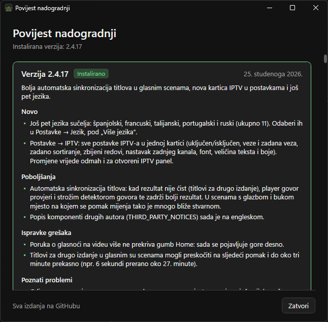</p>

Klikni broj verzije dolje desno na glavnom ekranu i odaberi **Povijest nadogradnji**. Svaka verzija ima datum, nove funkcionalnosti, poboljšanja, ispravke grešaka i poznate probleme. Povijest je uključena u player, pa radi i bez interneta; kad si na mreži, novije verzije s GitHuba prikazuju se na vrhu. Ista povijest je u [CHANGELOG_HR.md](CHANGELOG_HR.md) i na [stranici izdanja](https://github.com/jebaitedcro7/jebaited_player/releases).

---

## C. Napredne upute

### Automatsko pronalaženje titlova

Kad uz video nema titlova na prvom jeziku s tvog popisa, player ih sam traži na internetu. Za to treba barem jedan izvor s tvojim besplatnim računom; kratki vodič (desni klik → Titlovi → **Postavi titlove s interneta…**) otvori stranicu za registraciju, provjeri podatke i spremi ih.

| Izvor | Što treba | Napomena |
|---|---|---|
| OpenSubtitles.com (preporučeno) | Besplatan račun i besplatan API ključ | Jedini izvor koji prepoznaje točno izdanje po otisku datoteke |
| SubDL.com | Besplatan API ključ | Dodatni titlovi kad ih OpenSubtitles nema |
| Titlovi.com | Račun | Velika hrvatska baza; isključen dok ga sam ne uključiš |

- Titlovi se sami učitaju samo kad su za **isto izdanje** (otisak datoteke) ili ih potvrdi provjera prema govoru. Inače te player obavijesti, a ti biraš sam (Ctrl+F).
- Preuzeti titlovi spremaju se uz video (npr. `Film.hr.srt`), pa se sljedeći put učitaju i bez interneta.
- Besplatan OpenSubtitles račun ima dnevni limit preuzimanja. Player pamti preuzete titlove i nikad ne preuzima iste dvaput.
- Lozinke i ključevi spremaju se kriptirani (Windows DPAPI) i šalju se samo izvoru kojem pripadaju.

### Ručno preuzimanje titlova

<p align="center">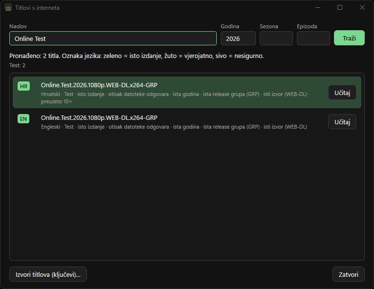</p>

**Ctrl+F** (ili CC → **Traži titlove na internetu…**) otvara pretragu. Naslov, godina, sezona i epizoda upisani su iz naziva datoteke; po potrebi ih ispravi i klikni **Traži**. Oznaka jezika pokazuje koliko je pogodak siguran: **zeleno** = isto izdanje, **žuto** = vjerojatno, **sivo** = nesigurno. **Učitaj** preuzme, provjeri i učita titlove.

### Sinkronizacija titlova

<p align="center">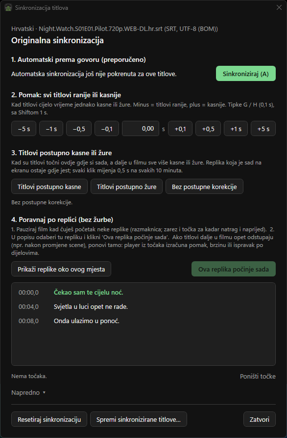</p>

Otvara se preko CC → **Sinkronizacija titlova…**. Gore piše trenutna korekcija. Korekcije se pamte po videu i titlu, a originalna datoteka se nikad ne mijenja.

1. **Automatski prema govoru (preporučeno).** Kad se učitaju vanjski tekstualni titlovi, player ih usporedi s govorom u videu i ispravi pomak, brzinu (npr. titlovi za 25 fps na videu od 23,976 fps) i skokove kod druge montaže. Primjenjuje samo provjeren rezultat. Kad rezultat nije čist, govor se provjeri još jednom strožim detektorom govora (zanemaruje više glazbe i buke) i zadrži se bolji rezultat. Titlovi druge epizode ili filma dobiju upozorenje. Ponovno: tipka **A** ili **Sinkroniziraj (A)**. Ugrađeni titlovi su već usklađeni i ne provjeravaju se.
2. **Pomak – svi titlovi ranije ili kasnije.** **G** / **H** pomiču za 0,1 s (Shift: 1 s, Ctrl: 10 ms), ili gumbi, ili upiši točan pomak u sekundama i pritisni Enter. Minus = ranije.
3. **Titlovi postupno kasne ili žure.** Kad su točni ovdje gdje si, a dalje u filmu sve više odstupaju: svaki klik mijenja 0,5 s na svakih 10 minuta; replika koja je sad na ekranu ostaje gdje jest.
4. **Poravnaj po replici (najtočnije).** Pauziraj kad čuješ početak replike, klikni **Prikaži replike oko ovog mjesta**, odaberi repliku i klikni **Ova replika počinje sada**. Po potrebi ponovi dalje u filmu: iz više točaka player izračuna pomak, brzinu ili ispravak po dijelovima.
5. **Napredno ▾ → Brzina za drugi FPS.** Gotove korekcije za 25 ↔ 23,976 ↔ 24 fps ili faktor brzine (1,0000 = bez korekcije). Samo kad su titlovi rađeni za drugi broj sličica.
6. **Stari način:** **Z** kad čuješ repliku, **X** kad se pojavi njezin titl (dvije točke dovoljno udaljene ispravljaju i brzinu).

**Resetiraj sinkronizaciju** (Ctrl+Backspace) vraća titlove kakvi su u datoteci. **Spremi sinkronizirane titlove…** sprema ispravljenu kopiju (npr. `Film.hr.sync.srt`).

### Podržani formati

| Vrsta | Formati |
|---|---|
| Video | MP4, MKV, AVI, MOV, WMV, FLV, WebM, MPEG/MPG, M4V, TS/MTS/M2TS, VOB, 3GP, OGV — H.264, HEVC, AV1, VP9, 4K i HDR, hardversko dekodiranje |
| Zvuk | MP3, AAC, FLAC, WAV, OGG, Opus, AC3, DTS, E-AC3, M4A, WMA, MKA |
| Datoteke titlova | SRT, ASS/SSA, WebVTT, MicroDVD i SubViewer (.sub), VobSub (.sub + .idx), TTML/DFXP, PGS (.sup) |
| Ugrađeni titlovi | Tekstualni (SRT, ASS, WebVTT, MP4 tekst) i slikovni (PGS, VobSub, DVB) |
| Kodiranja titlova | UTF-8, UTF-16, Windows-1250/1251/1252, ISO-8859-2 — prepoznaju se sama, mijenjaju se u izborniku titlova |

Arhive sa stranica s titlovima: ZIP je podržan, RAR još nije.

### Napredne postavke reprodukcije

- **Brzina reprodukcije** 0,5–2×: **+** / **−**, **Backspace** = normalna, ili desni klik → **Brzina**.
- **Omjer slike:** **O** ili desni klik → **Omjer slike** (izvorni, 16:9, 4:3, 1,85:1, 2,35:1, ispuni zaslon).
- **Snimka zaslona:** **S** s titlovima, **Shift+S** samo slika; sprema se kao JPG u punoj rezoluciji videa.
- **Encoding:** CC → Encoding, ako slova č, ć, ž, š, đ izgledaju krivo.
- **Zadani player:** Postavke → Općenito → Windows → **Postavi kao zadani player…**; otvorit će se Postavke sustava Windows, gdje klikneš „Postavi zadano”. Windows ne dopušta programima da to naprave sami.
- **Jedan prozor:** datoteka otvorena dok player radi ide u otvoreni player; više označenih datoteka otvara se kao jedan popis.
- **Iscrtavaj sučelje preko GPU-a:** zadano isključeno (pouzdanije); vrijedi nakon ponovnog pokretanja. Video uvijek koristi GPU.
- **Kvaliteta slike i dekodiranje:** Postavke → Slika — uravnoteženo (zadano), visoka kvaliteta (oštrije skaliranje, više opterećenje GPU-a) ili brzo (starija računala); hardversko dekodiranje može se isključiti ako je slika pokvarena.

### Tipkovnički prečaci

Tipke se mijenjaju u **Postavke → Prečaci**. Svaka radnja može imati dvije tipke: klikni tipku i pritisni novu kombinaciju (Esc odustaje, Delete briše tipku). Ako tipku već koristi druga radnja, player to javi, a drugi pritisak iste tipke premjesti je ovamo. **Zadano** u retku vraća zadane tipke te radnje, a **Zadano** za karticu sve tipke. F1 i izbornici uvijek pokazuju tvoje stvarne tipke. Esc, Enter, Alt+Enter, Alt+F4 i medijske tipke tipkovnice imaju stalnu ulogu i ne mogu se dodijeliti. Tablica pokazuje zadane tipke.

| Tipka | Radnja |
|---|---|
| Razmaknica / K | Reproduciraj / pauziraj |
| ← / → | Natrag / naprijed (5 s; korak se podešava u Postavke → Općenito) |
| Ctrl+← / Ctrl+→ | Natrag / naprijed 6× dulje (zadano 30 s) |
| Home | Na početak |
| ↑ / ↓ / kotačić | Glasnoća |
| M | Isključi / uključi zvuk |
| F / F11 / dvoklik | Cijeli zaslon (Esc za izlaz) |
| , / . | Kadar natrag / naprijed |
| N / P / L | Sljedeća / prethodna epizoda / popis epizoda |
| Ctrl+O / Ctrl+Shift+O | Otvori video / otvori mapu |
| Ctrl+T / Ctrl+F | Titlovi iz datoteke / s interneta |
| V / J | Prikaži ili sakrij titlove / sljedeći titlovi |
| G / H | Titlovi ranije / kasnije (100 ms) |
| Ctrl+G / Ctrl+H | Titlovi ranije / kasnije (10 ms) |
| Shift+G / Shift+H | Titlovi ranije / kasnije (1 s) |
| Z, zatim X | Sinkronizacija po replici |
| A | Sinkronizacija prema govoru |
| Ctrl+Backspace | Vrati originalnu sinkronizaciju titlova |
| B | Sljedeća audio traka |
| + / Num + | Brža reprodukcija |
| − / Num − | Sporija reprodukcija |
| Backspace | Normalna brzina |
| O | Omjer slike |
| S / Shift+S | Snimka zaslona (s titlovima / bez) |
| Ctrl+D | Dodaj u omiljene / ukloni |
| Ctrl+M | Mini player / natrag na puni player |
| Ctrl+R | Radio |
| Ctrl+Shift+S | Spotify |
| Ctrl+Shift+Y | YouTube Music |
| Ctrl+Shift+D | Bot za Discord |
| Ctrl+Shift+T | Torlink (pretraži online) |
| F1 | Svi prečaci |

### Nadogradnje i tvoji podaci

Player 20 sekundi nakon pokretanja i zatim svakih 12 sati provjeri na GitHubu ima li nove verzije, preuzme je u pozadini i **instalira kad ga zatvoriš** — ništa se ne prekida usred gledanja. U Postavke → Nadogradnje vidiš verziju, možeš provjeriti odmah ili isključiti automatsko preuzimanje.

Postavke (i jezik i tema), povijest gledanja, ključevi i predmemorija su u `%LOCALAPPDATA%\jebaited_player`, odvojeno od programa, pa ih nadogradnja ni ponovna instalacija ne diraju. Ako se datoteka postavki ikad ošteti, ostaje sačuvana sa strane (`settings.corrupt-….json`), a postavke se vraćaju iz zadnje automatske kopije.

Store inačica čuva podatke u `%LOCALAPPDATA%\Packages\jebaitedplayer.jebaitedplayer_5g6w8vrmj8ate\LocalState\jebaited_player` i nadograđuje se kroz Store.

### Rješavanje najčešćih problema

- **„Windows je zaštitio vaše računalo”** — program još nije potpisan: Više informacija → Ipak pokreni. Smart App Control: za GitHub inačicu mora biti isključen (vidi [Instalacija](#instalacija)); Microsoft Store inačica radi i uz uključen Smart App Control.
- **Ne pronalazi titlove** — provjeri je li postavljen izvor (Postavke → Titlovi → Izvori titlova (ključevi)). Ako je dnevni limit potrošen, pričekaj do sutra ili dodaj SubDL. Ručno možeš uvijek tražiti s **Ctrl+F** i tamo ispraviti naziv, sezonu i epizodu.
- **Titlovi su krivi ili se ne poklapaju** — ako player javi da se ne poklapaju s govorom, vjerojatno su za drugu epizodu ili izdanje: Ctrl+F i odaberi druge. Ručnu sinkronizaciju poništava Ctrl+Backspace.
- **Čudni znakovi umjesto č, ć, ž, š, đ** — CC → Encoding → Windows-1250 ili ISO-8859-2. Ako se to događa s većinom tvojih titlova, postavi to jednom u Postavke → Titlovi → Kodiranje starih titlova.
- **Bijeli ili prazni prozori** — u Postavke → Izgled → Napredno provjeri da je „Iscrtavaj sučelje preko GPU-a” isključeno (zadano).
- **Video se ne reproducira** — razlog je u logu: `%LOCALAPPDATA%\jebaited_player\logs\app.log`. Otvori issue na GitHubu i priloži log (u njemu nema lozinki ni ključeva).
- **Uklanjanje playera** — Postavke sustava Windows → Aplikacije → jebaited_player → Deinstaliraj. Uklanja se i „Otvori pomoću”. Postavke i povijest ostaju u `%LOCALAPPDATA%\jebaited_player`; obriši tu mapu ako ih ne trebaš.

### Privatnost

- Na internet idu samo: pretraga titlova (naziv, godina, sezona/epizoda, otisak datoteke) prema izvorima koje si postavio, prijava s tvojim računom tim izvorima i provjera nadogradnji na GitHubu.
- Lozinke i ključevi su kriptirani (Windows DPAPI, vezano uz tvoj Windows račun) i ne pišu se u log.
- Obavijesti (novosti, savjeti, nove verzije) dio su playera i ne trebaju dodatnu internetsku vezu.
- Nema statistike ni praćenja. Sve pojedinosti: [PRIVACY.md](PRIVACY.md).

### Prijevodi

Sučelje postoji na 11 jezika: English, Deutsch, Hrvatski, Bosanski, Srpski (latinica), Slovenščina, Español, Français, Italiano, Português i Русский (zadnjih pet prevedeno je bez provjere izvornih govornika; ispravci su dobrodošli). Svaki jezik je jedna datoteka u `src/JebaitedPlayer.Localization/Languages/`; novi jezik je kopija `en.json` s prijevodom. Ispravci su dobrodošli (issue ili pull request).

### Za programere

```powershell
# .NET 10 SDK; libmpv-2.dll se preuzme i provjeri (SHA256) skriptom:
.\tools\get-libmpv.ps1
dotnet build jebaited_player.slnx -c Release
dotnet test jebaited_player.slnx -c Release
```

**Dva odvojena izdanja (trajno pravilo):**

| Izdanje | Naredba | Torlink |
|---|---|---|
| GitHub | `dotnet build src/JebaitedPlayer.App -c Release` (instalacija i prijenosni ZIP preko `release.ps1`) | uključen (neobavezan, zadano isključen) |
| Microsoft Store | `.\tools\make-msix.ps1` (gradi s `-p:TorlinkEnabled=false`) | **nikad uključen** |

Store paket gradi se zasebno i bez Torlink modula: bez reference na projekt, bez simbola `TORLINK`, bez Torlink koda, datoteka, tekstova i zapisa o licencama. Skrivanje gumba nije dovoljno. `make-msix.ps1` provjerava gotov paket (nazive datoteka i sadržaj) i staje ako nađe išta od Torlinka; prije svakog Store izdanja ta se provjera i sadržaj paketa još jednom pregledavaju ručno i bilježe u popisu provjere izdanja.

### Licenca

[GPL-3.0](LICENSE). Komponente drugih autora i njihove licence: [THIRD_PARTY_NOTICES.md](THIRD_PARTY_NOTICES.md).
